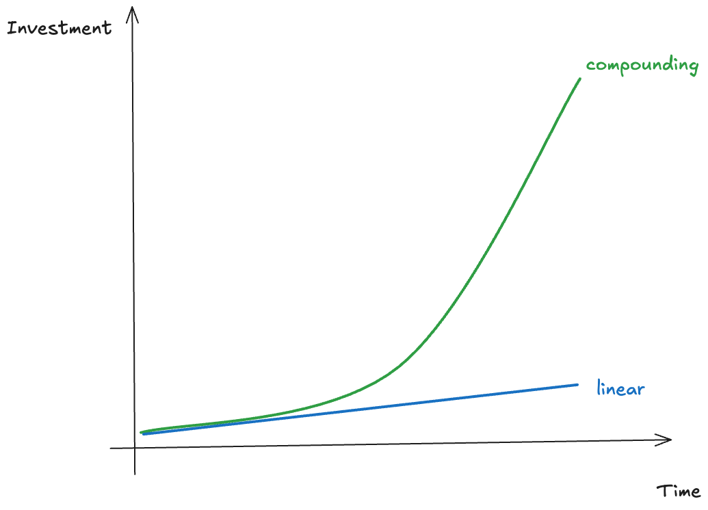

## The Wow Effect

When we think about ideal love, we picture a Hollywood story. Two people lock eyes across a room. Instant connection. Intense, unconditional, unquestionable. Love at first sight that lasts forever.

We like to think about perfect things as stable and fixed. Something that just *is*.

Alain de Botton, in his conversation with Chris Williamson, points out the problem with this view. We focus on finding the right person instead of learning how to live and solve problems with another human being. We think the main challenge is matching—finding someone compatible. But compatibility is a side effect of a good relationship, not the entry point.

We treat talent the same way.

We look for natural abilities. We wait for a spark, a sign that "this is for me." If it doesn't come easy at first, we assume it's not our thing. We expect the wow effect—and if it doesn't arrive, we conclude we're not talented.

But that's treating talent like a static essence. Something that either screams at you or doesn't exist at all.

In my previous post, [Talent as a Loop, Not a Gift](https://jorzel.github.io/talent-as-a-system-how-to-build-it-when-you-think-you-lack-it/), I argued that talent isn't something you passively discover—it's something you build through a positive reinforcement loop. But I've noticed a recurring reaction: people think I underestimate the impact of natural abilities. That I dismiss what they see as crucial for development.

Maybe they're right that I downplay it. But here's my actual stance: you don't have direct access to your natural abilities. There's no test, no detector, no a priori way to know what you're "naturally" good at. You need an active approach to make them visible. They reveal themselves through action, not introspection.

Natural abilities exist. But they're hidden. They exist in possibility, not actuality—until the right conditions bring them forth.

Like in relationships, the starting point matters. But our effort should go into building, not passively discovering. Waiting for the wow effect is dangerous in two ways. First, it might never come if you only wait. Some potential stays hidden without the right context. Second, even when a loop forms easily, we underestimate the effort to sustain it. We believe having "gifts" is enough—and stop building.

So instead of waiting, we need to invest beforehand.
---

## Invest First

> "Years into their work, they found something striking. They discovered that having a variant of a gene called 5-HTT does relate to becoming depressed. Yet there was a catch. We are all born with a genetic inheritance-but your genes are activated by the environment. They can be switched on, or off, by what happens to you. And Avshalom discovered-as Professor Robert Sapolsky explains-"that if you have a particular flavor of 5-HTT, you have a greatly increased risk of depression, but only in a certain envi- ronment." If you carried this gene, the study showed, you were more likely to become depressed-but only if you had experienced a terribly stressful event, or a great deal of childhood trauma. (They didn't test for most of the other causes of depression I've been talking about here, such as loneli- ness, so we don't know if they also interact with genes in this way.)”
J. Hari, Lost connections

When I say "natural talent is a myth," people hear something I didn't say. They think I mean tabula rasa—a blank slate where everyone starts equal and anything is possible with enough effort.

That's a false distinction.

Natural abilities exist. But they're not binary—you either have it or you don't. They're a spectrum. A range. Depending on how you actualize that range through practice and environment, you'll reach a specific destination. Your development is impacted by your genetic setup, but it's not fully determined by it.

Genes are activated by environment. They can be switched on or off by what happens to you. The same applies to abilities: your genetic setup creates possibilities, but those possibilities need the right conditions to become real.

Here's the problem: we overestimate what we can see (early signs of genius, end product) and underestimate what we can't (context, environment, character, compounding effort). We want to believe that talented people had a self-expressed essence from the beginning. In reality, there was probably only a small seed.

When we see a genius—Mozart, Einstein, a Nobel laureate—we assume there was a kind of necessity in their life. That their essence was always there, and success was just its manifestation. Then we look at ourselves and don't see any genius spark. So we get discouraged.

But this is usually wrong. In the middle of their journey, they didn't see the light at the end of the tunnel either. You don't have to be filtered out just because you don't show early signs of brilliance. In complex domains, late success is often more common than early breakthroughs.

I explored this in my post about [Karen Carpenter](https://jorzel.github.io/coming-out-of-the-shadows-how-karen-carpenter-developed-her-talent/). Paul McCartney called her "the best female voice in the world." John Lennon stopped mid-stride just to praise her. The kind of voice people assume must be pure, god-given talent.

But nobody looking at fifteen-year-old Karen saw a future genius. That label was reserved for her brother Richard. She was in his shadow for years—trying instruments that didn't fit, failing a singing audition, being told she couldn't sing. She found drums first and became obsessed with them. The voice came later, shaped by a choir director named Frank Pooler who spotted something others had missed.

Natural abilities were there. But they didn't scream. They needed context, persistence, and the right people to emerge.

Frank Pooler heard potential where others heard nothing special. Without him, that voice might have stayed hidden. Sometimes you can't see your own potential—you need someone else to help uncover it. A coach, a mentor, a parent who creates opportunity. You don't have to do this alone.

So what should you do instead?

The question shouldn't be: "Do I have talent?" That question is unanswerable from where you stand. The better question is: "Can I set up an environment where I'll love to practice this activity?"

This reframing doesn't make things easy. The amount of effort required—even in a well-designed, supportive environment—can be immense. But it shifts your focus from speculation to action.

And maybe your aim shouldn't be genius anyway. Maybe small improvement—being a better version of yourself after each iteration—is enough. We underestimate how far we can get by providing the right context and support. Compounding is real, but invisible until you're deep into the process.

Here's something counterintuitive: inspiration seldom creates sustainable action. It's action that creates motivation. You don't wait until you feel driven—you start, and the drive emerges from competence and small wins. This is another face of the loop. Motivation isn't the entry point; it's the byproduct.

The talent is not a fixed thing waiting to be discovered. It's dynamic—potentially both discovered *and* created. If you wait for the essence to express itself, you've already lost.

---

## The Pragmatic Approach

I once thought a lot about religious questions and came across William James's approach to religious belief. I liked it.

You cannot be sure whether God exists. The evidence isn't conclusive either way. You could spend your whole life waiting for certainty—or you could find a path where the question is suspended. A way to live meaningfully regardless of the answer.

This isn't blind faith. It's pragmatic commitment. You act without knowing whether the path is right—and let the results provide you some indication.

James's pragmatism asks: if two concepts lead to the same practical effects, are they really different concepts? What matters isn't abstract truth—it's what works.

I think a similar approach applies to talent.

You want to know whether you're talented before you commit. That's natural. In an ideal world, we'd have a genetic detector—sequence your genome, get an assessment, make an informed choice. But that world doesn't exist. And even if it did, genes don't work that way. They're not deterministic blueprints. They're potentials that need activation.

So you're stuck with uncertainty. The common sense approach says: verify whether the essence exists, then commit. But that's backwards. It is an illusion you can verify without commitment. The information you need only emerges through action.

Here's what I find clarifying. Whether talent is mostly genetic, mostly environmental, or an interaction of both—the practical action is the same: create test conditions and observe what happens.

![Diagram: Three theories (Genetic / Environmental / Interactive) → same action: Create Test Conditions]

Three different theories. Identical practical action. From a pragmatic perspective, the nature vs. nurture debate is theoretically interesting but practically irrelevant. Asking whether Mozart's talent came from gifts or environment is an intellectual riddle. It doesn't help you decide whether to pursue music or engineering.

What does help is a different question: Can I create conditions that might reveal or build ability? And then: Did it work?

Here's the reframe that matters. From your perspective, these two statements are equivalent:

1. "I don't have genetic gifts for music."
2. "I haven't created supporting contexts for musical development."

Why equivalent? Because you can't distinguish between them without testing. And if testing reveals no progress, you still don't know which was true—you only know the combination didn't work.

So stop speculating. Start experimenting. The loop is your verification tool.

---

## The Limits

In my previous post, I discussed when to persist and when to pivot. Here's the uncomfortable truth: there's no algorithm.

*"I've tested sincerely for 18 months. Tried different approaches. Had proper instruction. The loop still isn't forming. Do I persist or pivot?"*

This is where pragmatism meets its limits.

The fundamental problem: persist too little and you miss your true domain. Persist too much and you waste resources on the wrong path. No external indicator tells you which mistake you're making. Time-based rules, progress-based rules, enjoyment-based rules—none of them work reliably.

You're making a bet with incomplete information. Always.

There are signals—small progress visible, interest still present, external validation—that suggest one more iteration might work. And signals—zero progress, active dread, massive effort for tiny gains—that suggest it's time to pivot. But these are tendencies, not laws.

A few things help: diversify early, have clear iteration plans, seek external perspectives, be honest about trade-offs. None of this eliminates risk. But it's better than premature quitting or indefinite flailing.

---

## Conclusion

We're bad at visualizing compounding. We overestimate initial state and underestimate what accumulates over time. That's why we fixate on natural abilities—they're visible at the start. But the start isn't where the story ends.

Natural abilities matter. I've never denied that. They can provide more entry points to loops. They can make cycling faster. But they don't determine the outcome. Each development is constrained by where you begin—but it's not fully determined by it. The range is wider than you think.

The reframe I'm proposing isn't about denying reality. It's about teaching ourselves to put effort in the right place. Instead of speculating about essence, start building conditions. Instead of waiting for certainty, commit and observe.

This means committing to something you're not ready for. Like building a boat while you're already sailing. You don't get to finish the design before you launch. You launch, and you build as you go.

This isn't just about talent. It's a universal growth mindset.

The same pattern applies to relationships, careers, parenting, learning new skills—any domain where you can't know the outcome before you start. You want certainty first. But certainty only comes through action. The main thing is: change is possible. Not guaranteed, not easy, but possible. And if it's possible, the question shifts from "Do I have what it takes?" to "What can I do to find out?"

Talent development is just one example. The deeper lesson is about how we approach uncertainty itself.

We don't find "the one" in relationships—we build a partnership through years of solving problems together. Compatibility is a side effect, not a prerequisite. Talent works the same way. You don't discover a hidden essence waiting inside you. You iterate, you let the loop form or not—and you learn from what happens.

The question was never "Am I talented?"

The question is: "What can I build from here?"

That's a question you can actually answer.
