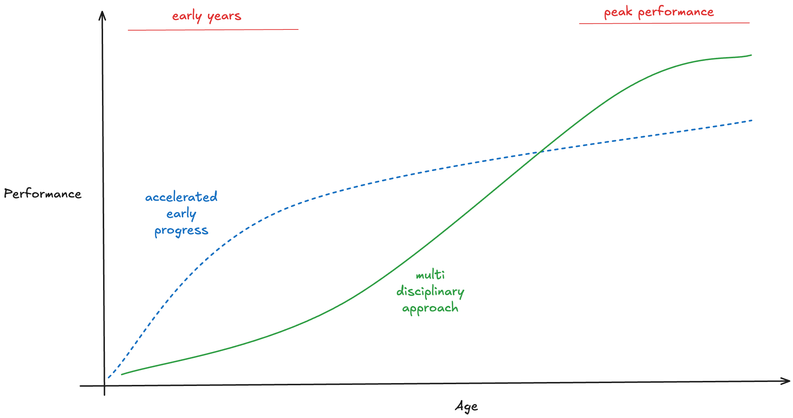
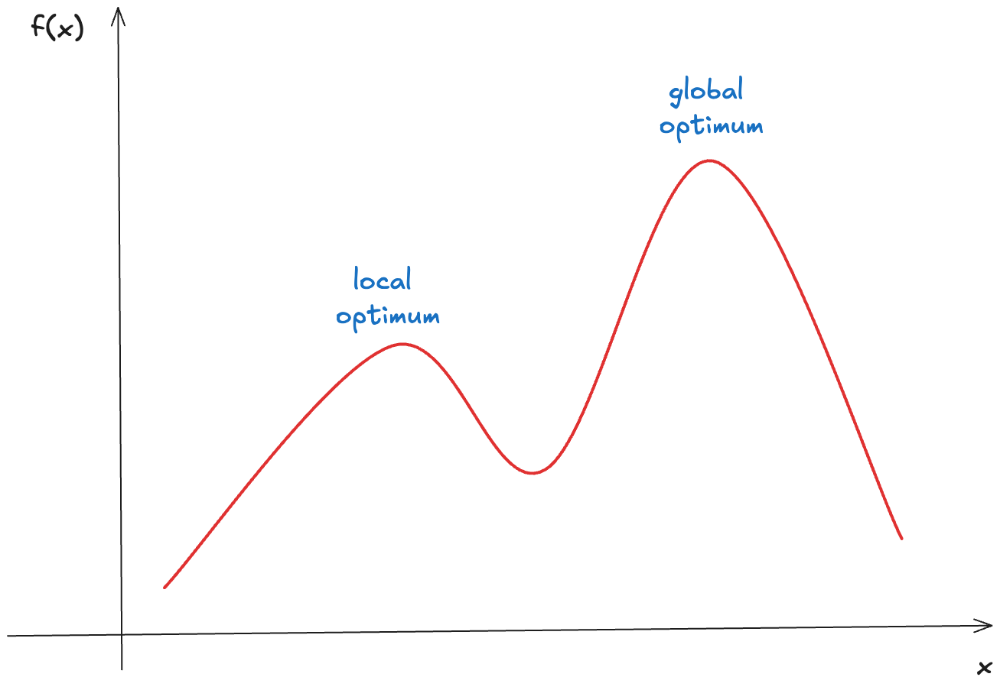

A new study published in *Science* analyzed nearly 35,000 elite adults across 19 studies. The finding? Only about 10% of world-class performers were top achievers as children. And the reverse holds too: only about 10% of child prodigies reached elite status as adults.

This pattern held across sports, music, chess, and scientific research. As lead researcher Arne Güllich put it: "Early exceptional performance is not a prerequisite for long-term, world-class performance."

The authors offer three potential explanations. First, broad exploration instead of early narrow focus allows you to find a domain where you'll truly thrive. Second, learning many different things improves the ability to learn itself, which can accelerate the learning process as an adult. Third, lack of pressure tied to a single domain decreases the risk of burnout in later stages.

All three align well with the loop concept. Broad search is essential before committing - you need time to explore before you know where to persist. The "learned ability to learn" strengthens the loop itself, making each new skill easier to acquire. And avoiding burnout is crucial for sustaining the loop through its different stages.

Early specialization always risks finding a local minimum. We see early success and pour everything into it. But for life security, redundancy is the safer approach. Even if you're good at something, it's useful - and robust - to cultivate other sources of enjoyment and competence. A wide range can also make you better in the domain you choose to persist in.

In wicked domains where feedback is delayed and rules are unclear, a wide range of skills is essential to thrive. But even in kind domains where feedback is fast, learning other skills can boost your character and scaffold abilities in later stages.

This research puts even harder emphasis on building over discovering. Even if you discover talent early, you can still fail. Focusing on one domain robs you of life redundancy - and that can be detrimental in the long game.

---

A caveat: some researchers point out this finding may be subject to selection effects. If you only look at people who became elite, and elite status can be reached via early success OR late development, then within that elite sample you'll naturally see a negative correlation between early and late performance - not because one causes the other, but because people who didn't have early success must have had strong late development to get into the elite sample at all. The correlation is real, but the causal story is less certain.
