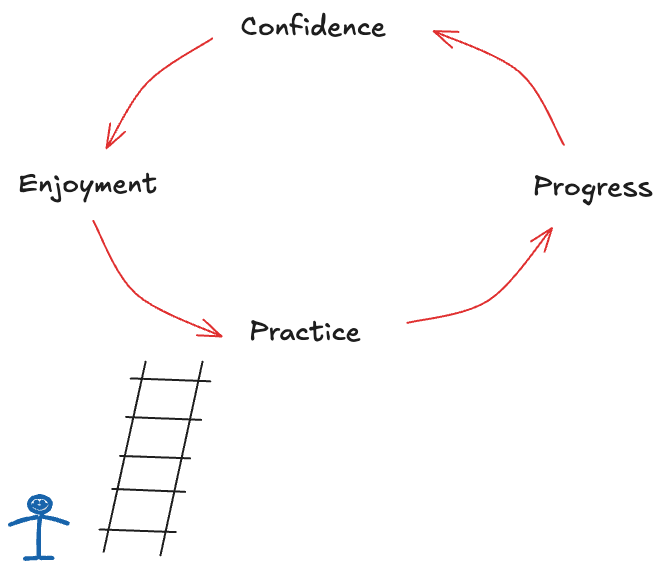
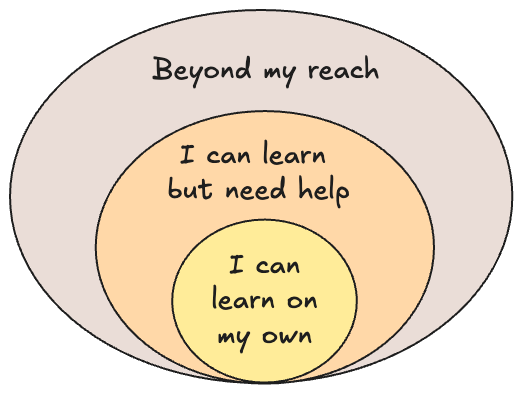
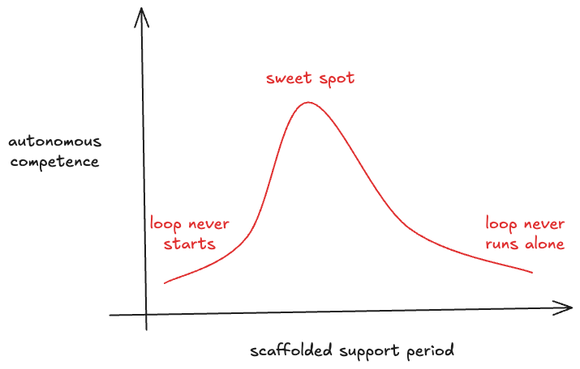
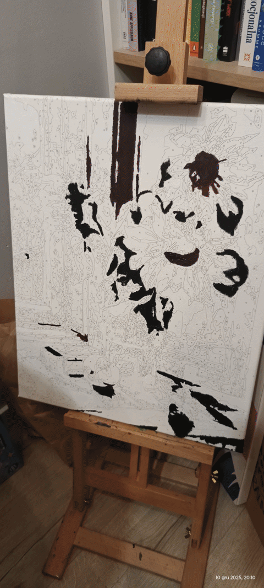

### How to make first steps easier

In "Talent as a Loop," I argued that talent isn't a gift — it's a system. A positive reinforcement loop: you practice, you improve, improvement feels good, so you practice more. The question isn't "Do I have talent?" but "Can I build the conditions where this loop starts spinning?"

That reframe matters. But it leaves a harder question unanswered: how do you actually build conditions for the loop to start?

Here's the problem. To practice, you need some enjoyment — or at least the willingness to keep going. To enjoy something, you usually need a bit of competence. And to build competence, you need practice. It's a chicken-and-egg trap. The loop needs momentum to sustain itself, but it also needs momentum to start.

Sometimes the answer is simple. You try something, you like it, and the loop kicks in on its own. Enjoyment drives practice, practice builds competence, and the whole thing takes off. No intervention needed. That's the easy path.

But what about when enjoyment doesn't come first? When you're starting from the competence side — trying to get good enough at something that you start caring about it? That's where it gets interesting. Because there are two very different strategies for building that early confidence, and from the outside they look almost the same.

The first is the self-esteem approach: tell someone they're capable, and hope the belief carries them through. "You're smart. You can do this." The idea is that if they feel confident, they'll persist long enough for real competence to arrive.

The second is scaffolding: adjust the challenge so that someone can experience a genuine win — not a fabricated one. The bar is lower, but the success is real. Then you raise the bar.

One inflates the person. The other calibrates the challenge. One produces fragile confidence. The other produces real, if small, competence. The rest of this post is about why that difference matters.

## The Self-Esteem Trap

The self-esteem movement had a simple logic: if we build strong self-esteem in children, they'll develop the confidence and resilience to persist through difficulty. And the way to build it? Praise. Tell kids they're capable, smart, special. Make them believe it. Once they believe it, they'll be confident — and confidence will carry them through.

It sounds reasonable. But it doesn't work.

Empty praise — "You're the best" — doesn't ignite loops. It eventually kills them. Several authors have converged on this conclusion from different angles.

Steve Magness argues in *Do Hard Things* that lasting self-esteem doesn't come from being told we're great. It should be a by-product of overcoming challenges and making meaningful connections — not the starting point. When we shift focus away from the joy of actually doing the work and toward external praise and rewards, we create an artificial kind of self-esteem. Fragile and based on delusion. Being loud doesn't signal confidence.

Jonathan Haidt makes an even sharper point in *The Happiness Hypothesis*: direct self-esteem enhancement can foster unstable narcissism. And unstable narcissism, when threatened by reality, can react with hostility and even violence. We should teach kids self-esteem based on skills they can actually be proud of — not on words disconnected from reality.

Martin Seligman saw this in children specifically. "You are the best" is usually false — and kids know it. When we rush to make a child feel better after a failure, we send a message: when things don't go as you want, give up and wait for rescue. Failure itself isn't bad for a kid. The interpretation of failure can be harmful. You can validate a child's feelings. But you can't solve the problem for them.

The self-esteem approach tries to skip the loop — to inject confidence without competence. But confidence without competence is a house built on sand.

## A Different Kind of Support

Scaffolding is temporarily lowering the bar so someone can experience genuine success, then gradually raising it.

It's like a ladder — you climb on it to reach a place you couldn't get to on your own, and once you're there, you throw it away. You don't need it anymore. The ladder wasn't the point. Getting up was.

Instead of inflating the person, you redesign the challenge. Not necessarily making it easier — but making it fit better. You change the context so that success is real but reachable. The bar is lower, but the win is genuine. And that first genuine win can be enough to get the loop spinning.

This isn't a new idea. Psychologists have a name for the sweet spot where scaffolding works: Vygotsky's Zone of Proximal Development — the gap between what a learner can do alone and what they can do with a bit of guidance. Jerome Bruner and colleagues built the scaffolding concept on top of it: provide high support when a task is new, then systematically withdraw it as competence grows. You're not pretending someone is competent. You're placing them where competence is within reach.

If you've read my earlier post on demand and support, this should sound familiar. Scaffolding is support that doesn't remove the demand — it calibrates it. Both must be flexible, contextual, dependent on age, skill, and emotional readiness. There's no formula. It's a judgment call every time.

And honestly, none of this is rocket science. A lot of parents and coaches scaffold without ever knowing the concept. They intuitively manage the context to allow progressing — adjusting difficulty, offering just enough help, stepping back at the right moment. If you can do that naturally, you don't need to overthink the process.

But some people get stuck. A stalled start, a plateau that feels like an ultimate wall. In those cases, it helps to think more deliberately about what you're doing. About activity design. About how to tinker with the conditions so that the first win becomes possible. Scaffolding gives you a framework for that tinkering.

Here's what it looks like in practice. A kid in gymnastics struggles with a routine. The coach has options. She can simplify the routine itself — break it into smaller pieces, let the child nail each one before combining them.

But she might also spot something deeper: the child's legs are too weak for the move. The scaffolding then isn't about the routine at all — it's about designing drills that build the underlying strength first. The child doesn't even realize she's being scaffolded. She's just doing exercises that happen to make the real challenge possible later.

Or take a math teacher with a struggling student. Instead of repeating the same problem and hoping it clicks, she gives a slightly easier version of the same type. The student solves it. Feels capable. Then gets the standard version. The confidence from that first success carries them through the second attempt. The teacher didn't lower her expectations — she lowered the entry point.

In both cases, the scaffolding isn't about removing the challenge. It's about finding the right challenge for right now.

## Knowing When to Let Go

Scaffolding has a built-in expiration date. Leave it too long and you create dependency — the coddling trap. Remove it too early and confidence collapses before the loop has a chance to sustain itself. Educational psychology calls this process "fading" — the deliberate, gradual withdrawal of support as competence grows.

There are two kinds of errors you can make here. The first: not helping when help is needed. "She needs to face the challenge. If she can't do it, it's not for her." The second: helping when help isn't needed. "She needs support. I always helped her and it worked."

There's no easy answer for which is worse. As always, it depends on the context and the situation. But you need to be aware of both. The overprotective parent who never lets go produces a different kind of damage than the hands-off coach who lets a beginner drown. Both break the loop — one by never letting it run on its own, the other by never letting it start.

The art is reading the signals. Is the person still relying on the support, or going through the motions out of habit? Are they starting to solve problems without prompting? Can they explain what they're doing and why? When you see those signs, it's time to step back — not all at once, but gradually. Let the loop prove it can carry itself.

## You Can Scaffold Yourself

Scaffolding isn't just something coaches and parents do for children. Adults scaffold themselves all the time — most just don't call it that.

You pick the beginner book instead of the advanced one. You join the slow running group. You start with the easy recipe before attempting the complex dish. You're not being lazy. You're engineering an early win so the loop has something to feed on.

Some environments do this for you automatically. Video games are the purest example — early levels are deliberately easy, teaching you mechanics through play. Difficulty scales with your skill. You never notice you're being scaffolded because it feels like fun, not instruction. Language apps like Duolingo work the same way — tasks sit right at the edge of your current ability, adjusted in real time.

I recently started painting by numbers. The scaffolding is built right into the canvas — outlines, numbered sections, matched colors. You don't need to know how to compose or mix. You just paint. But along the way, your hand gets steadier, your brush control improves, and you start noticing how colors work together. The structure lets you focus on the craft without the overwhelm.

At its core, self-scaffolding is designing and managing your own contexts — choosing the right level, the right environment, the right strategy for where you are right now. It's what "Talent as a Loop" called building conditions, applied deliberately at every stage.

The people who fail to self-scaffold do the opposite. They jump into the deep end, struggle, conclude they lack talent, and quit. They didn't lack talent. They skipped the ladder.

## A Loop Worth Building

The scaffolding trick isn't about lying to someone about their ability. It's about engineering a first genuine win so the loop has something to feed on. Then you step back and let the loop do its work.

And scaffolding itself is a skill — one you can learn. Whether you're a parent, a coach, a teacher, or just someone trying to pick up something new, getting better at reading when to support and when to let go is itself a loop worth building.
