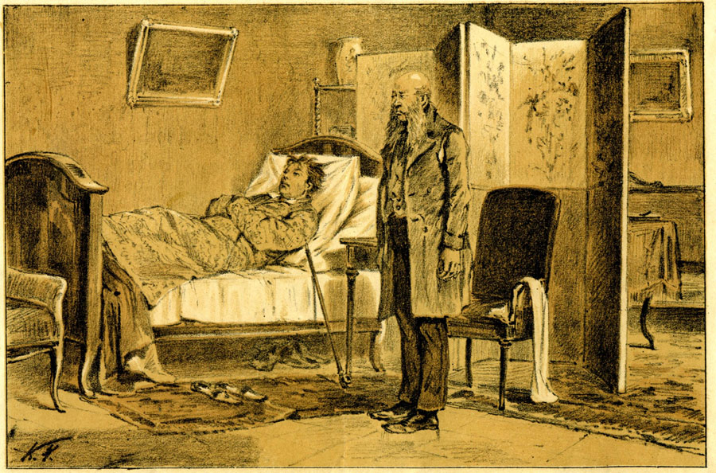

I first read *Oblomov* over ten years ago. I've reread fragments many times since. There are books with better language, sharper plots, more compelling heroes. But no other novel has stayed with me the way this one has.

What keeps pulling me back is its universality. Goncharov wrote a story about what happens when you're too scared to live — and that story hasn't aged a day. Every time I return to it, I recognize something. Not in some distant literary character, but in myself, in people I know, in the way we all sometimes hide from our own lives.

*Oblomov* is a life which is a warning. And the warning is worth hearing more than once.

## Meet Oblomov

Ilya Ilyich Oblomov is a young Russian nobleman living in St. Petersburg. He has an estate in the countryside, a servant named Zakhar, a circle of friends, and no particular reason to be unhappy. He is intelligent, kind-hearted, and well-educated.

He spends almost all of his time lying on the sofa.

> "Lying down was not for Oblomov a necessity, as it is for a sick man or for a man who is sleepy; or a matter of chance, as it is for a man who is tired; or a pleasure, as it is for a lazy man: it was his normal condition." [1]

Oblomov has plans. He's been working on a scheme to reorganize his estate for years — in his head. He has letters to write, visits to make, decisions about his apartment. He postpones all of it. Tomorrow, next week, some other time. His study is dusty, the inkwell dried up, the newspapers from last year. Visitors come and go. Life happens around him, not to him.

That's the setup. A man with every possibility and no motion. What Goncharov does with this character over four hundred pages is what makes the novel extraordinary — not because the plot is dramatic, but because the diagnosis is so precise.

## The Dreamer

Oblomov is not lazy in the way you might expect. He's not indifferent to life — he's deeply convinced that real life exists somewhere beyond the ordinary. Beyond the career chase, the small talk about unimportant things, the daily errands that eat your hours. Somewhere out there, he believes, is a purer existence — one worthy of an intelligent person. Focused on reflection, thinking, stability. Free from the noise.

This is his deepest conviction: that life can be divided into what's proper and what's soiled. The everyday is beneath him — not because he's arrogant, but because he genuinely believes that mundane problems only hinder a person from reaching something higher. Work is punishment. Repetition is safety. Cautiousness is wisdom. And the ideal? Inactivity and peace.

He paints this vision for his friend Stolz in extraordinary detail:

> "'Well, I'd get up in the morning,' began Oblomov, putting his hands behind his neck, and his face assuming an expression of repose (in his thoughts he was already in the country). 'The weather is lovely, the sky is as blue as blue can be, not a cloud. While waiting for my wife to waken, I'd put on my dressing-gown and go for a walk in the garden, for a breath of fresh morning air. There I'd already find the gardener and we'd water the flowers together and prune the bushes and trees. I'd make a bouquet for my wife. Then I'd have my bath or go for a swim in the river. On my return, I'd find the balcony door open. My wife is wearing her morning dress and a light cap which looks as if it might be blown off any moment.… She is waiting for me. "Tea's ready," she says. What a kiss! What tea! What an easy-chair!'" [1]

It's beautiful. It's poetic. And it's a fantasy designed to never be tested by reality. Peace as the ultimate goal. He doesn't postpone life because he's lazy. He postpones it because he's waiting for conditions to be perfect. The estate plan needs more work. The apartment situation isn't resolved. Tomorrow will be better.

## The Ship That Never Leaves Port

"A ship is always safe at the shore, but that is not what it is built for," John A. Shedd wrote. Security is important in life. It provides a stable foundation from which you can stretch yourself, take risks, grow. But for Oblomov, security isn't the foundation. It's the whole building. He wants to be a ship that never leaves port.

And here's the cruel irony: his pursuit of security makes him deeply insecure. He doesn't act, so he never builds competence. Without competence, he has no confidence. Without confidence, every decision feels terrifying. So he avoids decisions, which keeps him incompetent, which keeps him afraid. It's a spiral going the wrong way.

His opposite is his childhood friend Stolz — half-German, self-made, dynamic, restless, always looking for the next thing.

> "'Work means everything to me, it is the very breath of life — of my life, at any rate.'" [1]

These two represent the poles: striving for peace versus striving for growth. They understand life in completely different ways. But Goncharov is honest enough not to pretend that Stolz has all the answers. Even Olga — the woman who once loved Oblomov and later married Stolz — in her accomplished, active life asks at one point: "Is this all — all?" Pure action without reflection has its own hollowness.

Still, the novel leaves no doubt about which direction is more dangerous. Oliver Burkeman calls it the "problem-free future" [2] — the conviction that real life begins once we've sorted out all our current issues. You never arrive at the good part, because the good part doesn't exist separately from the messy, ordinary, everyday one. Arthur Brooks makes the complementary argument [3]: it's really difficult to find meaning in life without struggle. Having problems and obstacles that need to be overcome is part of what makes a life feel worth living. They provide goals. They provide satisfaction when you succeed. Oblomov stripped himself of all of this by abandoning life.

And without struggle, purpose vanishes too. When Olga asks Oblomov why he's sad, the exchange is devastating:

> "'Find something to do and spend more time with other people.' 'Find something to do! I could do that if I had some aim in life. But what is my aim? I haven't one.' 'The aim is to live.'" [1]

It doesn't occur to him that he could create his own meaning. He waits for it — the way he waits for everything. Purpose, for Oblomov, is something that should arrive from outside.

There's a concept called the optimal failure rate [4] — research suggesting that we learn best when we fail about 15% of the time. If you never fail, it doesn't mean you're doing well. It means you're not trying enough. You're hiding. You lost before you played the game. Oblomov's failure rate is zero — not because he succeeds at everything, but because he attempts nothing.

A ship that never leaves port doesn't just stay safe. It rots.

## The Music Box

Oblomov believes his fate is sealed. Oblomovka — the estate where he grew up — didn't just root him. It gave him a destination. His parents shielded him from every difficulty, handed him to servants for every basic task, and taught him that work was punishment. Laziness wasn't something he chose. It was formed by a lazy life.

Stolz sees this clearly:

> "'It all began with your inability to put on your socks and ended by your inability to live.'" [1]

Oblomov accepts this verdict. He tells Stolz that others can do it — they're able, they're built for action. But not me. I'm not made for these things. He doesn't argue. He agrees with the diagnosis and does nothing about it. Oblomovism didn't just shape his character. It became his identity, his excuse, his destiny.

He's like a music box. When someone winds him up — Stolz with his energy, Olga with her love — he plays. He reads, goes on excursions, writes letters, comes alive. But the moment they let go, silence. He returns to his baseline: the sofa, the dressing-gown, the stillness. Oblomov waits for motivation to arrive as inspiration, from outside. But motivation is seldom born from inspiration. Both are built on action — and action is the one thing he won't take.

If life is change, restlessness, movement — did Oblomov ever want life at all? Or did he want a safe imitation of it?

## The Warning

Here's what makes *Oblomov* more than a simple cautionary tale about laziness. His diagnosis of life is correct.

He sees through the hollow busyness, the careerism, the endless striving for things nobody truly cares about. He wants more from life — something deeper, more aligned, more honest. In a way, he wants what Thoreau wanted [5]: to abandon the futile world and live with integrity. But Thoreau went to the woods and built a cabin. He kept a journal. His simplicity was an act of will. Oblomov abandoned the world and then did nothing. He made the first step — rejecting a life he found hollow — but took no others. Without the second step, the first one leads nowhere. Abandoning the world without imposing your own path results in sloth and stagnation.

Olga sees this with painful clarity:

> "'Just do what is necessary. It's an old trick of dishonest people to offer sacrifices which are unnecessary and which cannot be made so as to get out of making those that are necessary.'" [1]

Oblomov offers grand insights instead of small, necessary actions. He'd sacrifice his life for love, he says — but he won't write a letter or visit an office.

And the cruelest part of the warning: he knows all of this. In Part 4 of the novel, Oblomov sees his life with total clarity:

> "'I know, I am aware of it.… Oh, Andrey, I am aware of everything and I understand everything: I have for a long time been ashamed to live in the world! But I can't go on the same road as you even if I wanted to.… Now it is too late.'" [1]

Understanding your tragedy does not save you from it. He wept "disconsolate tears for his bright ideal of life that had now vanished for good" — and then settled "quietly and gradually into the plain and spacious coffin he had made for his remaining span of life."

He eventually got the life he dreamed of. With Agafya — a woman who made no demands, no challenges, who asked nothing of him — he found perfect domestic peace. And it killed him. He died "just like a clock that has stopped because it has not been wound up."

We're usually not the best judges of what is good for us. Even when we get exactly what we want.

There's a saying that you can't build a strong character and live an easy life. They're both sides of the same coin. Maybe it's impossible to have both a calm life and growth. Both deep reflection and the courage to act. If you have the passion to live, it's hard to think deeply about it. And if you think deeply enough, you may lose the will to act.

I recognize this tension in myself. My default state is to strive for security. Avoid issues, avoid problems, avoid risk. From a short-term perspective, each day the same as the last feels like the safest option. But it makes life too simple. You don't gather experience. You don't provide real growth. You just repeat yourself, safely, until there's nothing left to repeat. That's what Oblomov does — and every time I reread the novel, it reminds me how close that pull is.

Oblomov's warning runs deeper than "don't be lazy." You can fail at the diagnosis — misunderstanding what's wrong with your life. You can fail at the implementation — knowing what to do but not doing it. But you can also fail at something more fundamental: building the right mental model of what the diagnosis means for you and how to direct your life from there. Oblomov got the diagnosis right. He just couldn't turn it into a life.

The novel ends by closing on itself. Stolz meets a writer and tells him Oblomov's story, so that "someone may find it useful."

> "'He's dead. He wasted his life! And he was as intelligent as anybody, his soul was pure and clear as crystal — noble, affectionate, and — he perished!'" [1]

---

## References

[1] Ivan Goncharov, *[Oblomov](https://www.amazon.com/Oblomov-Penguin-Classics-Ivan-Goncharov/dp/0140449876)* (1859)

[2] Oliver Burkeman, *[Four Thousand Weeks: Time Management for Mortals](https://www.amazon.com/Four-Thousand-Weeks-Management-Mortals/dp/0374159122)* (2021)

[3] Arthur Brooks, *[From Strength to Strength: Finding Success, Happiness, and Deep Purpose in the Second Half of Life](https://www.amazon.com/Strength-Finding-Success-Happiness-Purpose/dp/059319148X)* (2022)

[4] [The Optimal Rate of Failure](https://www.askell.blog/the-optimal-rate-of-failure/) — Askell blog

[5] Henry David Thoreau, *[Walden](https://www.amazon.com/Walden-Henry-David-Thoreau/dp/1505297729)* (1854)
