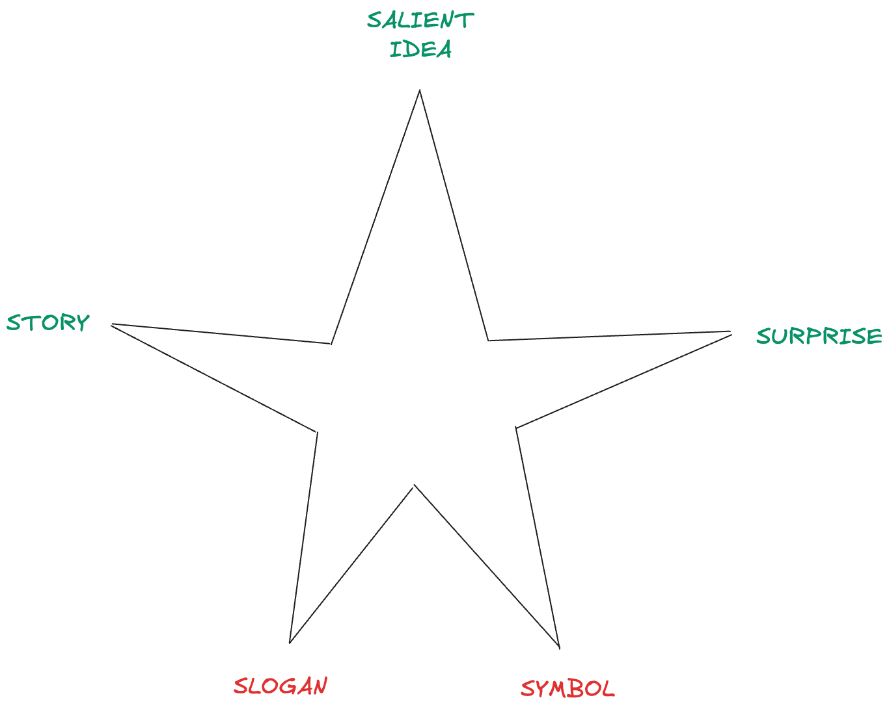

### Why Some Concepts Stick and Others Don't

You write something you're proud of. You think it's genuinely useful. You publish it — and almost no one reads it. The idea was good, but it never reached anyone.

Other times, the opposite: you get views, clicks, people open it — but they don't stay. They skim and leave. The content didn't hold them.

Two different failures, two different causes. Patrick Winston (MIT) identified five elements that make ideas recognizable and memorable. In this post, I'd like to explore what it takes to make your ideas recognizable and stick with the audience.

## The Five Elements

Patrick Winston spent years thinking about what makes ideas travel. In his [legendary MIT lecture on how to speak](https://www.youtube.com/watch?v=Unzc731iCUY), he landed on five elements. He called them the Winston Star.

I find it useful to think of them in two layers.

**The interface layer** is what people encounter first. It's the reason someone clicks on an article, picks up a book, or shows up to a talk already curious about what they're going to hear.

**Symbol** — a quick visual representation. A diagram, a metaphor, an image. Something you can draw on a napkin or picture in your head without reading a single word of explanation.

**Slogan** — a short phrase that gives a handle to the idea. If someone asks "what was that article about?" and the reader can answer in one sentence — you have a slogan. If they can't, the idea has no handle to grab.

These two are like a book cover or an article title. They don't carry the depth — but without them, nobody gets to the depth. A brilliant insight with no symbol and no slogan is an unlocked door that nobody knows exists.

**The content layer** is what makes people stay and remember.

**Surprise** — something that breaks expectations. A counterintuitive claim, an inversion of common wisdom. This is what makes someone pause and think "wait, really?" Without surprise, the idea feels obvious — even if it isn't.

**Salient idea** — the core insight that sticks out. Not a collection of points, but one clear reframe that changes how you see the problem. The thing you'll remember a month later when everything else fades.

**Story** — how you got there, how it works, why it matters. Stories ground abstract ideas in concrete experience. They give the reader something to retell — and retelling is how ideas spread.

The interface gets people through the door. The content makes them stay. You need both. A great slogan with no depth is clickbait. A great insight with no handle is invisible.

## The Star in Action

When I first encountered Winston's idea, I tried to rewind some of my essays and do a validation check: do they meet the five criteria? It turned out to be a surprisingly useful exercise.

Take my article "Talent as a Loop." The **symbol** is the loop diagram itself — a circle with arrows connecting practice, competence, and enjoyment. You can draw it on a napkin. The **slogan** writes itself: "Talent is a loop, not a gift." The **surprise** is that competence can come before enjoyment — you don't need passion first. The **salient idea** reframes the whole question: not "Do I have talent?" but "Can I build the conditions for the loop to start?" And the **story** is personal — I went from hating programming during my studies to becoming an engineer I'd now call talented. The loop formed backwards from the cliché.

All five elements are there. Some stronger than others, but none missing. And I think that's why this particular idea resonated more than some of my other writing.

You can spot the same pattern in ideas that traveled far beyond their original domain. "Broken windows" is a good example. The **slogan** is the name itself — two words. The **symbol** is immediate — you picture a broken window without anyone having to draw it for you. The **surprise** is that one small sign of disorder invites more. The **salient idea** is that environment shapes behavior — small things can eventually have great positive or negative impact. And the **story** is concrete: in the mid-1980s, New York City was struggling with high crime. George Kelling, the author behind the broken windows theory, was hired as a consultant to the Transit Authority. His approach was counterintuitive — instead of targeting violent crime directly, they started with the small stuff. Removing graffiti from subway cars. Cracking down on fare evasion and public drinking. When these policies scaled city-wide under Mayor Giuliani, crime dropped.

A criminology theory became common vocabulary in management, urban planning, and even software engineering — where "broken windows" now means: don't let small code issues pile up, or the whole codebase degrades.

The theory itself is debated. But the idea stuck — and it stuck because the Star was complete.

## The Diagnostic

Not every idea needs a perfect Star. Some of my own essays have a strong slogan and a sharp surprise — but no visual symbol, no personal story. The ideas aren't bad. But they don't travel as far. They're harder to retell, harder to picture, harder to remember a week later.

That's the real value of the Star — not as a formula for manufacturing viral ideas, but as a diagnostic. When something you wrote doesn't land the way you hoped, you can ask: which element is missing? Can someone draw it? Say it in one sentence? Retell it as a story? If not, you know where to look.

The Star won't make a weak idea strong. But it can stop a strong idea from staying invisible.
