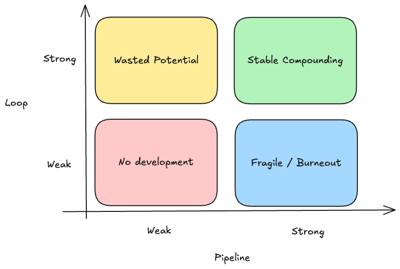
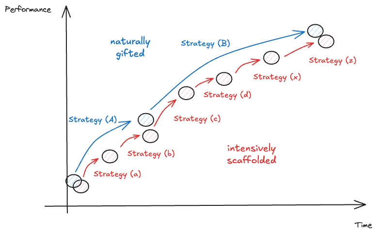

## The Scene

A seventeen-year-old boy stands on the starting block. He's decent. Trains five or six days a week, has since he was a kid. His coach thinks he's solid — quick off the block, good technique, real commitment. At his level he's one of the faster guys in the pool. But nobody's offering scholarships. No national team selector has ever written his name down. He's the fast kid at the club — serious, dedicated, unremarkable.

His best time in the 100m freestyle: 57.3 seconds. Good enough for AA level — top 10 to 16 percent of competitive swimmers in his age group. Impressive by any normal standard. Invisible to elite selectors.

Now imagine we send him back in time. July 1952. Helsinki. The Olympic final. Eight men on the blocks, the best swimmers on Earth. The crowd, the flags, the world watching.

He dives in. Swims his usual race, at his usual speed, with his usual body. Nothing special — just what he does on a regular Tuesday in training.

He touches the wall. He looks up at the scoreboard.

He's won. Olympic gold. By a tenth of a second.

Clarke Scholes, the actual 1952 champion, swam 57.4. Our boy — an AA-level swimmer who wouldn't turn a single head at a modern elite meet — has just beaten the best swimmer on the planet.

Nothing about that boy is extraordinary. Not his genetics, not his training, not his talent. Some things have changed in seventy years, of course. People are taller on average. Nutrition is better. Swimsuits have improved. But none of that explains the scale of the shift. Taller people and better food don't turn an unremarkable club swimmer into an Olympic champion. What does explain it is everything that happened to the training environment between 1952 and now — seventy years of accumulated knowledge about how to teach people to swim. Better coaching methods. Better technique analysis. Better understanding of periodization, race strategy, how bodies move through water. A pipeline of knowledge that didn't exist in 1952 and is now so ordinary, so embedded in every decent swim club, that it mass-produces performances that once required the best athlete alive.

The gene pool didn't change. The pipeline did.

(Source: USA Swimming 2024-2028 Motivational Time Standards [1]; AA 17-18 boys 100m free LCM: 57.39s. Clarke Scholes, 1952 Olympic gold, 100m freestyle: 57.4s.)

---

## The Pipeline

That story isn't hypothetical. The numbers are real.

USA Swimming ranks competitive swimmers using motivational time standards — letter grades, essentially, from B at the entry level up through AA, AAA, and beyond. AA represents the top 10 to 16 percent of competitors in a given age group. Serious. Dedicated. Not elite.

The AA standard for 17-18 year old boys in the 100m freestyle is 57.39 seconds — one hundredth of a second faster than the 1952 Olympic gold. A seventeen-year-old in the top percentile of his age group, training hard, competing regularly, matches the best swimmer on Earth from seventy years ago. He wouldn't attract a single elite recruiter today.

This is not one exceptional kid. USA Swimming has roughly 300,000-400,000 registered competitive athletes. The AA standard describes tens of thousands of swimmers. Today's ordinary training infrastructure mass-produces what once required the best athlete on Earth.

The question is: what changed?

Most people treat giftedness and talent as the same thing. Françoys Gagné spent decades arguing they're not [2]. Giftedness is what you arrive with — untrained, spontaneous natural ability. Talent is what a developmental system produces — systematically built mastery. The gap between the two is where almost everything interesting happens.

We obsess over measuring the input. We almost never design the gap.

I call that gap the pipeline. And the pipeline has a relationship with something I described in an earlier article — the positive reinforcement loop. Practice leads to improvement, improvement produces enjoyment, enjoyment drives more practice. That loop is the engine of talent. But the engine needs a track to run on.

The loop operates inside a person. The pipeline operates around them. The pipeline builds the conditions under which the loop can start, run efficiently, and survive the hard periods. Without a pipeline, even a strong loop generates naive practice — repetition without traction. With a pipeline, the same person's effort compounds.

The 1952 Olympic champion had a loop. Our seventeen-year-old has a loop too. The difference isn't the engine. It's the track.

The combinations matter. A passionate person without a pipeline practices obsessively but plateaus — and blames their ceiling for what is really a strategy gap. A well-designed pipeline without a loop produces technically trained people who perform inside the system and stop the moment external structure disappears — or worse, burn out entirely, the domain forever associated with obligation rather than curiosity.

Only when both work together does talent compound. And over time, a well-built pipeline makes itself unnecessary — the loop becomes self-sustaining, the external track internalized. Elite performers look naturally gifted partly because the pipeline that built them has become invisible. This invisibility is the source of the natural talent myth.

---

## The Digit Span Proof

The swimming argument is compelling but physical — someone might object that bodies change, training science improves, nutrition matters. So here is the same argument in a controlled laboratory, with no physical confounders.

In 1956, George Miller published one of the most cited facts in psychology: human short-term memory holds about 7 plus or minus 2 chunks of information [3]. Not individual digits or letters — chunks. A chunk is whatever your mind treats as a single unit. The number was accepted for decades as a fundamental biological constraint.

In 1980, Ericsson, Chase, and Faloon ran an experiment [4]. Their subject, Steve Faloon — a university undergraduate explicitly selected for average memory and average intelligence — started where Miller's law predicted: a digit span of 7.

After 230 hours of practice over two years, he could recall 79 digits.

Here's what's crucial: his short-term memory didn't expand. He still held roughly 3 to 4 groups at a time — within Miller's limit. What changed was entirely the encoding strategy. Faloon was a competitive runner. He learned to chunk digit strings into running times — "3492" became "3 minutes, 49.2 seconds" — packing more information into each chunk. Then he built a hierarchical retrieval structure in long-term memory, a mental scaffolding that let him rapidly store and retrieve far beyond the short-term bottleneck.

The proof that this was strategy, not capacity: when researchers gave Faloon consonants instead of digits, his span didn't improve at all. He couldn't map consonants onto running times. The hardware was unchanged. Only the encoding pipeline changed.

The bottleneck remained. The pipeline routed around it.

The 7 plus or minus 2 limit was real — and it still is. But what people *did* with that limit turned out to be almost entirely a function of strategy. The boundary of human memory performance wasn't biological. It was the current frontier of applied encoding knowledge.

The same kind of frontier that placed the 1952 Olympic gold at 57.4 seconds.

---

## The Knowledge That Accumulates

In 1968, Dick Fosbury won Olympic gold in the high jump by going over the bar backwards [5]. Within a generation, every elite jumper used the Fosbury Flop. The old technique wasn't wrong — it was a pipeline frontier. A single insight, shared through the network, permanently raised the floor for everyone who came after.

Chess tells the same story across centuries. Garry Kasparov argued in *My Great Predecessors* [6] that a well-prepared modern grandmaster would have a significant edge over historical world champions — not because modern players are more gifted, but because they inherit generations of codified knowledge. Opening theory, endgame databases, engine-assisted preparation. What Capablanca worked out through years of intuition, a modern club player downloads before breakfast.

This is the mechanism behind the swimming proof. No single coach invented modern freestyle technique. Thousands of coaches across decades each contributed a small improvement — a better catch angle, a smarter taper protocol, a new way to read race splits. Each insight entered the network. The network compounded.

Pipeline knowledge works differently from natural ability. You can't inherit your father's reaction time. But you can inherit his coaching methods. Natural ability resets to zero with every generation. Pipeline knowledge accumulates. As Joseph Henrich puts it: "If you want to have cool technology, it is better to be social than smart" [7].

Even where a physical or natural ceiling seems real, it can often be routed around — the way Faloon routed around short-term memory limits, the way Fosbury routed around the straddle technique, the way modern swim coaches route around the biomechanics that constrained 1952. The ceiling stays. The pipeline finds a different path.

But this raises a question the evidence alone can't answer.

---

## The Deeper Question

Every ceiling in this article turned out to be a pipeline frontier, not a biological wall. Which raises the question I always wanted to answer: can the pipeline always keep up with natural advantage?

In "The Scaffolding Trick" I described Vygotsky's Zone of Proximal Development — the gap between what someone can do alone and what they can do with help. A scaffold works within that zone. But a pipeline isn't a single scaffold. It's a sequence — each one expanding what's reachable, moving the zone forward, making the next scaffold possible.

Now picture two people. One sits at a piano and something clicks — the notes make sense, the fingers find their way, the loop ignites on contact. No scaffold needed. The other struggles, stalls, needs a teacher to lower the bar and engineer a first win before anything starts moving.

The pipeline can get the second person started. But the first person improves faster at every stage — each step simply costs them less. To stay close, the second person doesn't just need a pipeline. They need a better one than what natural advantage provides for free.

Is the sequence of scaffolds long enough? Can it extend fast enough? Or does the naturally gifted person always stay one step ahead?

I don't know. And I think that's the honest answer — more honest than either side of the debate usually admits.

The pipeline model says: if you fail, build a better pipeline. Find a new strategy. Redesign the environment. That claim is not falsifiable — you can always argue the right strategy hasn't been found yet. But the genetic ceiling claim has exactly the same problem. When someone says "this person hit their natural limit," you can never prove a better pipeline wouldn't have worked. You'd need to test every possible design, and that's an infinite search space.

You can prove a ceiling is false — by breaking through it. You can never prove a ceiling is true — because a better pipeline might exist that you haven't tried yet.

Both positions are equally unfalsifiable. Neither is science in the strict sense. What we have is a pattern: every time we've confidently declared a natural ceiling, the pipeline has eventually broken through it. That pattern doesn't guarantee the next ceiling will fall. But it should make us deeply suspicious of any specific claim that "this is the real one."

The pipeline model is not a scientific law. It is a philosophical framework informed by evidence. It says: I don't know where the natural floor is. No one does. And since no one can know, the question becomes what to do with that uncertainty.

Here, at least, the answer is practical. When you hit a wall, the first response is not to quit — it's to change the pipeline design. New strategy. New coach. New environment. A different sequence of scaffolds. Don't quit when you're failing — quit when you stop learning. And when you stop learning, redesign the pipeline first. Only if, after genuinely testing multiple designs, you still can't improve — then the design space is exhausted for you in this domain, and it's time to move on.

When we say someone lacks talent, we are almost always describing the absence of a well-designed pipeline — not the absence of potential. The question that follows is not "is this person gifted?" It is: "what would a good pipeline look like for this person right now?"

---

## Series Links

- [The Myth of Natural Talent](https://jorzel.github.io/the-myth-of-natural-talent/)
- [Does Mastery Require Giftedness?](https://jorzel.github.io/the-talent-debate-does-mastery-require-giftedness/)
- [Talent is a Loop](https://jorzel.github.io/talent-as-a-system-how-to-build-it-when-you-think-you-lack-it/)
- [Why You Must Invest Before You Know](https://jorzel.github.io/why-you-must-invest-before-you-know/)
- [Why Child Prodigies Rarely Become Superstars](https://jorzel.github.io/why-child-prodigies-rarely-become-superstars/)
- [The Scaffolding Trick](https://jorzel.github.io/the-scaffolding-trick/)
- [When Deliberate Practice Isn't Enough](https://jorzel.github.io/when-deliberate-practice-isnt-enough/)

---

## References

[1] USA Swimming, 2024–2028 Motivational Time Standards. usaswimming.org.

[2] Gagné, F. (2010). Motivation within the DMGT 2.0 framework. *High Ability Studies*, 21(2), 81–99.

[3] Miller, G. A. (1956). The magical number seven, plus or minus two: Some limits on our capacity for processing information. *Psychological Review*, 63(2), 81–97.

[4] Ericsson, K. A., Chase, W. G., & Faloon, S. (1980). Acquisition of a memory skill. *Science*, 208(4448), 1181–1182.

[5] Olympics.com, [When high jumper Dick Fosbury changed the game. Forever.](https://www.olympics.com/en/news/when-high-jumper-dick-fosbury-changed-the-game-forever)

[6] Kasparov, G. (2003–2006). *My Great Predecessors*, Volumes 1–5. Everyman Chess.

[7] Henrich, J. (2015). *The Secret of Our Success*. Princeton University Press. Cited in Syed, M. (2019). *Rebel Ideas*. John Murray.
