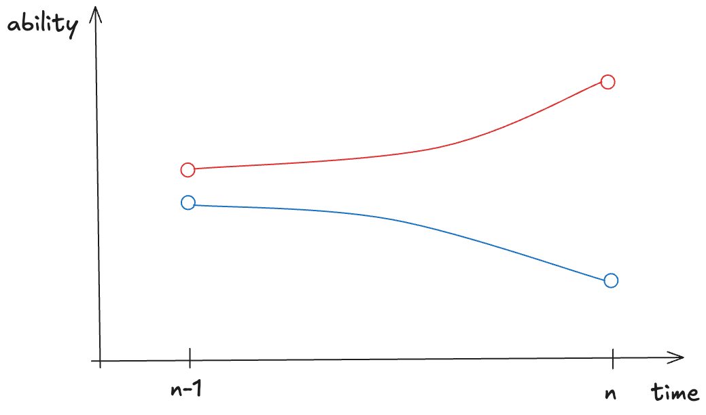

## "It's okay, not everyone is good at math"

> "I noticed that some students seemed to understand the material effortlessly, whereas I required more time to process things. Even so, I wondered whether that actually made me learning disabled. It seemed that no matter where I went, or what I did, I couldn't escape that label. I was placed in special education and entered an environment where the teachers had very low expectations for my future success. But deep down I knew that I was capable of more. All I wanted was a chance."
>
> — Scott Barry Kaufman, *Ungifted* [1]

*"It's okay, not everyone is good at math."*

It sounds honest. It sounds humble. It sounds compassionate. People are different — different characters, different desires, different abilities. So what could possibly be wrong with that sentence?

Nothing, as a description of the current state. As a diagnosis of what to do about it, almost everything.

This isn't about whether people differ in performance. They do. It's about what we believe should follow from that fact — and the framing decides almost everything. *"It's okay, not everyone is good at math"* can mean: let's identify the ones who already do well and concentrate our resources there. It can also mean: let's look harder at the ones who are struggling, and ask why — and what would change that. Same sentence. Opposite stance.

The trap isn't that the sentence is false. The trap is that it feels like the most reasonable thing anyone could say. The labeler sounds kind. The labeled person nods along. Everyone agrees, and the question stops being asked.

Once accepted, the label does something quiet and durable: it outsources the answer to the future. The person stops being the subject of an experiment about who they could become, and turns into its predicted outcome. Whatever happens next is the label's doing, not theirs.

It also tends to corrupt itself in two symmetric directions. If the label is *non-gifted*, the response is passive: *"I'm not it. Why bother."* The person withdraws. The effort isn't worth it if the verdict is already in. If the label is *gifted*, the response is defensive: don't reveal a gap, don't risk a visible failure, don't do anything that could put the label at risk. One side stops trying. The other side stops trying anything hard. Both lose the data that would have changed the picture.

Then the label calcifies. Once *"I'm not a math person"* is the story you tell yourself, every difficult moment becomes confirmation; every easy moment becomes a fluke. The label preempts exactly the data that would have falsified it.

The alternative isn't refusing to assess. People really do start in different places, and pretending otherwise helps no one. The alternative is refusing to confuse *assessment* with *verdict* — and asking what's actually going on underneath.

## The Mechanism: Multiplier and Inverse Multiplier

> "People, more often than not, do what is expected of them."
>
> — Robert Rosenthal & Lenore Jacobson, *Pygmalion in the Classroom* [2]

So why is labelling wrong?

Because it assumes something modern science has largely abandoned: that the thing being measured is a stable, fixed trait — a hidden essence sitting somewhere inside the person, waiting to be uncovered by the right test. Plenty of debate remains about how much of any given ability comes from genes and how much from environment. But the older picture — that ability is fixed at birth, and the rest of life just reveals it — has been set aside by the field for decades.

Human beings are dynamic, non-linear systems. The defining property of such systems is that small differences in input can produce wildly different outcomes. Development is a process, not a state. What we see when we test someone is a snapshot — and the snapshot was produced by the inseparable dance of natural setup and environmental input. The label looks at the snapshot and decides it's seen the system.

It hasn't. It's seen one frame of a long movie.

The frames don't just sit there. They compound. Each acquired skill reshapes the next stretch of the path — sometimes by deepening what you already do, sometimes by unlocking a route that wasn't accessible before. Reading lets you self-teach. Numeracy unlocks abstraction. One sport's coordination transfers to the next. The system runs forward, and the forward run changes which futures are available.

This is what makes the multiplier effect possible. The first signs of ability draw attention. Attention draws encouragement. Encouragement draws practice. Practice produces visible improvement, which draws more attention, more praise, more practice. The snowball is rolling almost before anyone realizes there's a hill.

The same mechanism runs in reverse. Sort a kid out early — *not promising, not the right type, not really a math person* — and the snowball never starts. The kid loses the attention, the praise, the practice, the seriousness of expectation that other kids get.

But the damage isn't only the absence of practice. It's the active version: avoidance. The child learns to escape the activity altogether. Math class becomes something to endure, music becomes something other people do, sport becomes a place to hide. Each missed period isn't a flat zero — it's a forfeited compound, a stretch of development that won't be there later when it would have mattered.

If the kid does later decide to try, the gap to peers has grown into a wall. The peers had years of multiplier; the kid had years of escape. Even genuine effort now meets a distance that intimidates more than the original task ever did. Sorting *creates* the gap it claims to be measuring — and the gap then defends itself.

And the closing of the trap is quiet. Robert Rosenthal's Pygmalion experiments showed that what teachers expect of a student becomes part of what the student receives — fewer demanding questions, less patience for second attempts, less of the difficulty that produces growth. The belief shapes the treatment, and the treatment shapes the outcome. *Sorted low* doesn't just describe a child. It changes the room around the child.

By the time anyone goes back to check, the original assessment looks correct. The child performed exactly the way the label predicted. No one asks whether the label produced the performance — because the label preceded it.

## Building From Here

> "Progress is a natural result of staying focused on the process of doing anything."
>
> — Thomas Sterner, *The Practicing Mind* [4]

If labelling is wrong, what's left? Notice where someone is — and refuse to call it a destination.

Predisposition is not predetermination. Genes, temperament, early environment — these can tilt the path. They don't decide it. The labelling stance collapses the two; every tilt becomes a verdict. The building stance keeps them apart. It treats the current snapshot as a starting state — *this is where we begin, what's the next move from here?* — not a sentence on who someone is.

The building stance gives up something real: the comfort of being able to predict the whole trajectory in advance. We don't get to know where the kid ends up. But that comfort was never available anyway — dynamic systems don't show you their ten-year outcomes from one snapshot at age six.

Keep the long-term goal in view — it tells you which way to face. But don't try to *do* it all at once. Looking at the full distance is usually how people get overwhelmed and quit: *too far, too much, not for me*.

What you actually do is the next step — the smallest piece of progress you can make from here. The next conversation. The next practice session. The next month of attention.

You take it, see what happened, adjust, take the next one. That's the only point where you can change the path — and it's available right now, for the kid in front of you, for yourself, for whoever you're talking to.

The building stance is patient about endings and impatient about starts. It doesn't ask *will this kid become a mathematician?* It asks *what's the smallest piece of math she could love this week?* It doesn't ask *am I going to be world-class at this?* It asks *what's the next iteration that will help?*

There's an asymmetry in the bet worth naming. If labelling is right and we build anyway, we spend some effort that wasn't strictly necessary — the world wasn't going to bend, but we tried. If labelling is wrong and we sort instead, we forfeit a trajectory that was actually available.

And we'll never see what we forfeited, because the inverse multiplier hides it. The kid never enters the practice that would have shown otherwise. The adult never starts the loop that would have compounded. The lost path looks, from the outside, like proof that the path wasn't there. It is a self-fulfilling prophecy.

This doesn't promise that every kid becomes extraordinary. The point isn't equality of outcome. The point is to stop confusing the present sort with the available trajectory.

The real options were never *Mozart or nothing*. They were never *Federer or stop playing tennis*. The interesting space lives between *exceptional* and *unable* — and most of it is reachable from where we already stand. Not the next Mozart, but enough to play your favorite song on guitar. Not a Nobel in economics, but enough math to study sociology. Not the next Federer, but good enough to enjoy a weekly game.

The whole posture only makes sense if you believe change is real. If the system is fixed, every iteration is just data about the verdict, and labelling reasserts itself no matter what we call our practice.

Carol Dweck calls this *growth mindset over fixed mindset* [3] — treating ability as something built rather than uncovered. Thomas Sterner's *The Practicing Mind* [4] points to the practice-level partner: *process over product* — staying with the work in front of you rather than measuring yourself against the destination. Both are preconditions that let any of this matter.

So: don't refuse to assess. Refuse to confuse assessment with verdict. Pay attention to what someone can do today, then ask what the next move from here is — and act on it, while *here* is still the place you can act from.

Some things really are outside our control. Genes, early environment, the household someone was raised in. But within everything else, we still have influence — even when it feels smaller than we'd want. Sorting is how we quietly abandon it. The label sounds like a description; it is often a withdrawal.

The comfort you give up is the sense of having someone figured out. What you gain is something quieter and more durable: the next needed step. In a dynamic system, that's the only honest posture.

---

## References

[1] Scott Barry Kaufman, *[Ungifted: Intelligence Redefined](https://www.amazon.com/Ungifted-Intelligence-Scott-Barry-Kaufman/dp/0465025544)* (2013).

[2] Robert Rosenthal & Lenore Jacobson, *[Pygmalion in the Classroom: Teacher Expectation and Pupils' Intellectual Development](https://www.amazon.com/Pygmalion-Classroom-Expectation-Intellectual-Development/dp/1904424066)* (1968). [Full PDF](https://gwern.net/doc/statistics/bias/1968-rosenthal-pygmalionintheclassroom.pdf).

[3] Carol Dweck, *[Mindset: The New Psychology of Success](https://www.amazon.com/Mindset-Psychology-Carol-S-Dweck/dp/0345472322)* (2006).

[4] Thomas Sterner, *[The Practicing Mind: Developing Focus and Discipline in Your Life](https://www.amazon.com/Practicing-Mind-Developing-Discipline-Focus/dp/1608680908)* (2012).
