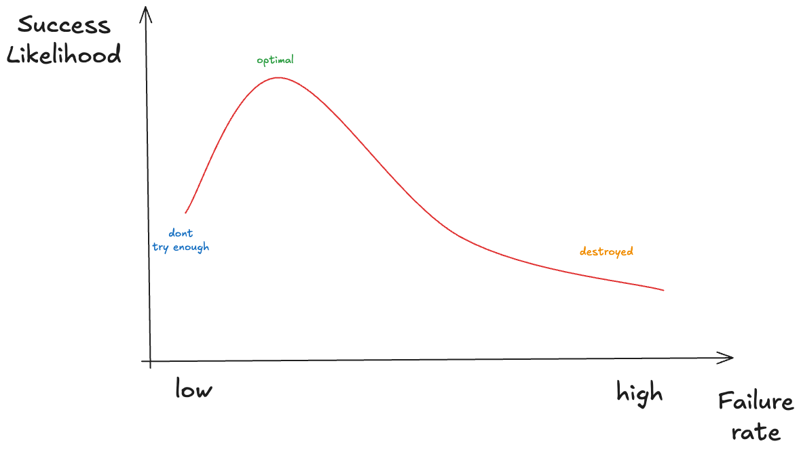
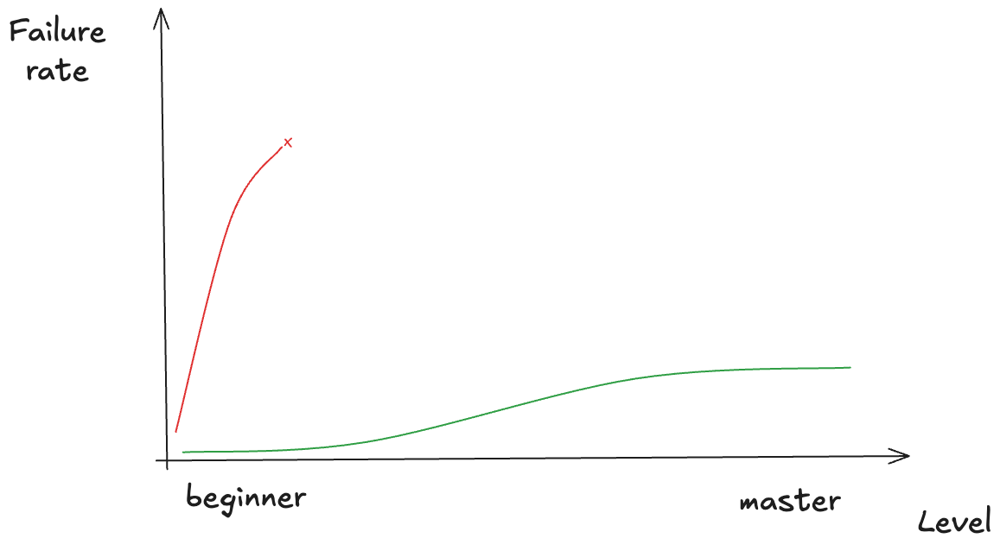

Newton's apple. Archimedes' eureka moment. Tesla sketching the AC motor in the sand of a park. These images live vividly in our minds as moments of genius — and they probably *were* genius. But each of those short moments was built on years of learning, failing, thinking, and tinkering. The moment is impressive; the path is hidden.

None of them would have been possible without a slow compounding of knowledge and skill. Compounding is hard to see from day to day. It's slow. It adds, refines, readjusts, reinforces — and then waits for a tipping point to explode. So we shouldn't judge by the moment. We should appreciate the process.

And even if ability isn't equally distributed, anyone who wants to progress has to keep that process running — through dead ends, plateaus, and long stretches where nothing seems to move. That's where most people stop. Motivation gets you going. But motivation fades, and what carries you past the failures is resilience: the ability to stay in the game.

## Resilience Needs a Design

Resilience is one of the most important traits for long-term success. Maybe the most important one. And it's hard — because it's counterintuitive. You have visible proof of your own incompetence: losses, failures, stalled progress. And yet you need a belief that it's temporary, transient. So resilience is something you have to design.

I like the concept of an [optimal failure rate](https://www.nature.com/articles/s41467-019-12552-4). The number of failures you hit tells you something about how much you're stretching yourself. No failures doesn't mean you're great and skillful — it usually means you're not trying hard enough. That's an invisible failure.

So the solution is to just fail a lot and accept it, right? It's not that easy. Timing matters too. The effect of failure on belief depends on when it lands: in early stages, failure is usually just demotivating; in later stages, overcoming an obstacle can build confidence. We need to be able to handle failure — but we also need to succeed first, to see that we *can* overcome difficulties.

Push too hard too early and the failure rate spikes before any belief exists to absorb it — and people quit. Keep it low at the start and raise it as competence grows, and the same person tolerates far more failure later.

Handling failure is a skill of its own. Roger Federer put numbers on it. In his [2024 Dartmouth commencement speech](https://home.dartmouth.edu/news/2024/06/2024-commencement-address-roger-federer), he pointed out that he won almost 80% of his matches — but only 54% of the points. Even the best lose nearly every second point.

The resilience isn't in specific numbers or rates. It's in not letting the lost point live in your head. "When you're playing a point, it has to be the most important thing in the world," Federer said. "But when it's behind you, it's behind you." You learn from the last point. You don't ruminate on it. Dwelling poisons the next one.

But handling failure isn't enough. We also need wins. Mastery experiences — your own past successes — are the strongest source of [self-efficacy](https://www.simplypsychology.org/self-efficacy.html), the belief that you can do something. Success is the best teacher. So when we learn something, or teach someone else, designing the process matters: set up the conditions to build a positive track record in the first steps.

That design takes many forms. Fading scaffolding — making the first tasks easier and more straightforward, then removing the support once the learner can stand on their own. Sometimes it's more robust fundamentals. Sometimes it's emotional or financial support. The environment has to be adaptive and flexible.

Role models matter too. People who went through a similar path and came out the other side — people we can look at when we struggle. We're often unsure what's good for us, what choice to make. So we watch and imitate the people who do it right. Copying is the best way to start.

We talk about resilience as if it were a trait — something you either have or you don't. Some of that is real. But a lot of what looks like character is really design: the optimal failure rate, the timing, the early wins, the fading scaffolding, the role models. None of those are fixed. They're things you can work on.

And resilience is worth working on. It's a long-term investment — slow to build, easy to underrate. But it's what keeps the process running long enough to compound. To stay in the game.
