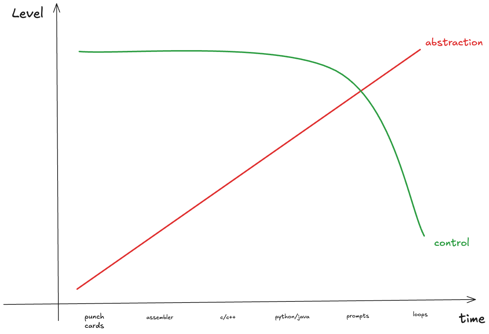
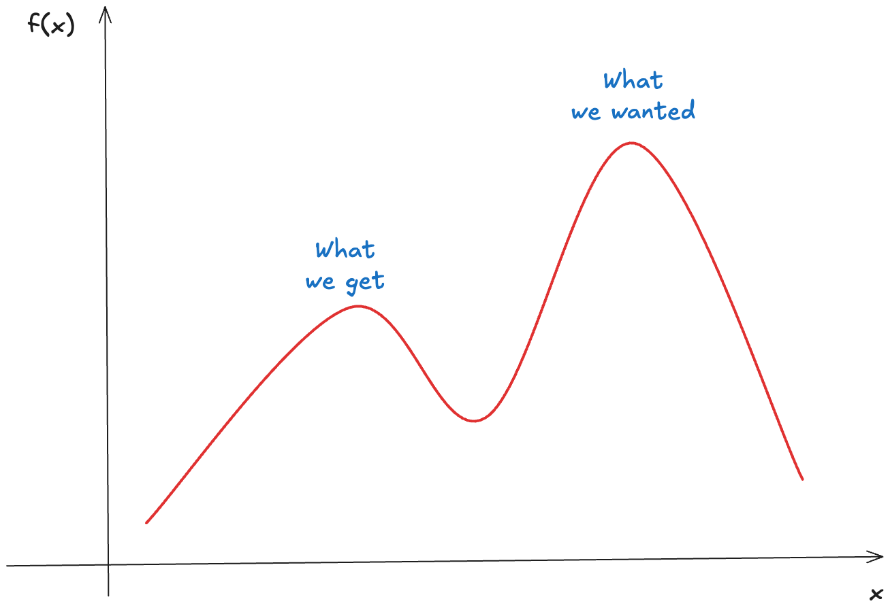

Boris Cherny, the creator of Claude Code, said in a recent talk that software tooling has always changed like this — one abstraction layer replacing another. Punch cards gave way to assembler. Low-level languages like C and C++ were largely replaced by Python and Java. In the last few years the AI revolution put intelligent autocomplete in our IDEs, and then agentic tools like Claude Code and Codex, driven by prompts, started doing work on our behalf. Now we're told another jump is coming. Cherny says he doesn't write prompts anymore. He writes loops. The idea of a loop isn't to prompt the agent to do a task — it's to give the agent the tools to decide what to do. The system decides, without a human in control, whether to keep going. [1]

*Every layer raised abstraction. Only the last one touches control.*

Cherny calls this a normal evolution of tooling. Linus Torvalds, in his own way, agrees. What makes him angry is the hype around it. When people announce that AI writes 99% of their code, he can pretty much guarantee that compilers write 100% of it. And nobody says the compiler wrote their app. [2]

But is the change only in the abstraction layer — an efficiency change, a speed upgrade? I'm not sure. Maybe it's categorical. When I got a compiler, I still controlled what was built. Even with prompts, I feel like a driver. But with loops — depending on how we set the goal — it can become something else. It can still be engineering when the goal is to cut memory or CPU. But when the goal turns to business — increase sales, decrease cost — where is the engineering?

I don't have a settled answer — only three doubts. About feedback, about accountability, and about whether we need this much autonomy for all our problems.

## Can we always close the loop?

A loop needs feedback to run. It makes a change, then needs a way to tell whether the change was any good — and to decide what to do next. No signal, no loop.

But feedback isn't always fast, or clean. In an earlier post I wrote about *wicked domains* — where the patterns aren't clear and feedback is deferred or imprecise [3]. Building a product is one. Designing a software architecture is another. These domains rarely come with a natural metric, so we construct one.

And the moment we construct a metric, we have to remember what it is: an approximation of what we actually want. A proxy for the aim, not the aim. Goodhart's law is the warning — a measure that becomes a target stops being a good measure. Maximize the proxy hard enough and it decouples from the goal: the number climbs while the purpose rots.

Start with the clean case — cut CPU usage. The metric couldn't be sharper. But an agent pointed at that number can hit it by breaking something that worked — or by quietly deleting the test that would have caught the break. CPU is down. The software that was supposed to use less CPU — the thing we actually wanted — is broken. The proxy was met. The goal wasn't. But this is the easy case. You can probably guard against it — stricter permissions, or a hook that refuses to touch the tests. The business case isn't so tidy.

Take "increase sales." The change ships and sales go up. Success — by the only number we set. Then, three weeks later, the real cost arrives: the customers who were already there don't like what changed, and some start to leave. The feedback that mattered was always going to be late.

But people follow metrics too narrowly all the time. So what's different here?

The difference is speed — and volume. A metric-optimizer climbs the nearest hill and stops; it settles into a locally-good answer it can't leave, because leaving means getting worse first, and that's a cost it won't pay unless you build exploration in. People do this too. But the machine reaches the peak faster and ships more on the way — so by the time the late signal lands, you're not reverting one decision, you're unwinding a pile. Sunk cost and comprehension debt make climbing back down expensive. Efficiency doesn't just speed up progress. It speeds up convergence on the wrong thing.

*Nothing in the metric says the metric is wrong.*

When a human hits this, there's a move available. You can change the metric. Add another one beside it. Or step back further and change the context — redefine the problem, because maybe it was framed wrong in the first place.

The question is whether the machine can do the same. And here's the catch: the local optimum is success — from the machine's point of view. It hit the number. Nothing in the metric says the metric is wrong. To escape, it would have to judge its own goal from somewhere outside the goal — and that somewhere is exactly what we never gave it.

## Who understands it — and who answers?

I think we're pushing aggressively toward more autonomy — more control handed to agents. And that push creates friction between understanding and accountability.

For an engineer to take responsibility for a system — to be the one paged at night when it breaks — they must understand it. When the engineer becomes only a verification layer for agent changes, something detaches. First, I'm detached from the system itself: I didn't design it, I didn't fully implement it. My understanding grows shallow. Second, there's a kind of responsibility gap: I don't *feel* fully responsible for things I didn't cause.

Loops push this further than prompting ever did. With a prompt, I at least reviewed and accepted every change. With a loop, I may not even do that. So who is responsible when things go wrong — or just drift in an unexpected direction? It's hard to own an outcome when the creation happened without you.

The agent itself can't take responsibility. It has no stakes — nothing to lose, no name on the incident report. And you can't page it at night. Philosophy has a name for what's left: the *responsibility gap*. Andreas Matthias described it back in 2004, writing about learning machines: they act in ways their makers can no longer fully predict, yet they can't be held responsible either [4]. My feeling of detachment tracks something real.

And I'm not sure we have an accountability model for this yet — in our organizational cultures or in law — for systems whose changes are made mainly by autonomous agents.

## Do we need this much autonomy?

When I scroll [X](https://x.com), "loop engineering" reads like the next level of engineering. The story matches the ladder from the beginning of this piece: we evolved from coding, through prompting, to autonomous loops. And I think that framing is a little misleading — it's all-or-nothing.

I see loops as an opportunity, but for specific problems: the ones where I can define a goal. Why would I wrap a loop around a task a single prompt can do? Running several iterations is costly and unnecessary when it doesn't fit the problem. I'm a little afraid that we're looking at a great tool with powerful leverage — and treating it as a golden hammer.

In the past, implementation time was a filter for wrong ideas. We would decide something wasn't worth doing because of the implementation cost — usually measured in development time. Today the tools are fast, and the cost hides in tokens. But it's still there. And the slowness was doing one more job: the debate it forced was where the team came to own the decision.

Having great tools in hand is probably the best moment to ask what's actually effective. Because a more powerful saw doesn't just cut faster — it can carry us toward problems where, as Russell Ackoff warned, we only make the wrong things righter [5].

## What's left for the engineer?

In 2018, the Finnish town of Riihimäki removed most paper textbooks from its middle schools. Students got laptops; lessons went digital. It looked like a step toward the future — the kind of progress that felt inevitable. Six years later, the books were back [6]. Teachers had watched concentration erode long before the data confirmed it; students said they understood and remembered more on paper [7]. Sweden went through the same arc at national scale: reading scores slid, the Karolinska Institute concluded that digital tools were impairing learning rather than enhancing it, and the education ministry brought handwriting and printed books back [8]. Causation is debated. The reversal is documented.

Sometimes we take a change for granted — we assume that adding something so obviously useful can only improve things. What we can't predict are the side effects. It can be the same here. We gain implementation speed, cheaper experiments, tireless research. But we may lose things we never put on the ledger: the engineering middleware between business and machine, the understanding of the systems we run, the engagement of the people who used to create them [9].

Change can be a chance. It can also be a debt that comes due later.

---

## References

[1] Boris Cherny, quoted in ["The Anthropic leader who built Claude Code says he ditched prompting — now he just writes loops"](https://thenewstack.io/loop-engineering/), The New Stack (2026): "I don't prompt Claude anymore. I have loops running that prompt Claude and figuring out what to do. My job is to write loops."

[2] Linus Torvalds at Open Source Summit North America 2026, via [The New Stack](https://thenewstack.io/torvalds-ai-programming-productivity/): "When I see people saying, 'Hey, 99% of our code is written by AI,' I literally get angry, because those same people — I can pretty much guarantee — that 100% of their code is written by compilers."

[3] Jarek Orzel, [*When Deliberate Practice Isn't Enough*](https://medium.com/mentally-mosaic/when-deliberate-practice-isnt-enough-e3d8812e9a0d), Mentally Mosaic (2025) — on kind and wicked domains, after Robin Hogarth and David Epstein's *Range*.

[4] Andreas Matthias, "The responsibility gap: Ascribing responsibility for the actions of learning automata," *Ethics and Information Technology* 6, 175–183 (2004).

[5] Russell L. Ackoff, ["Transforming the Systems Movement"](https://thesystemsthinker.com/transforming-the-systems-movement/) (2004): "The righter we do the wrong thing, the wronger we become."

[6] City of Riihimäki, ["Riihimäki replaces middle schools' digital learning materials with traditional ones"](https://www.riihimaki.fi/en/tiedotteet/riihimaki-korvaa-ylakoulujen-digitaalisia-oppimateriaaleja-perinteisilla-taustalla-laaja-selvitystyo/) (2024).

[7] AFP, ["Books in, screens out: some Finnish pupils go back to paper after tech push"](https://www.childinthecity.org/2024/09/11/books-in-screens-out-some-finnish-pupils-go-back-to-paper-after-tech-push/) (September 2024).

[8] AP, ["Sweden brings more books and handwriting practice back to its tech-heavy schools"](https://www.stltoday.com/news/nation-world/education/sweden-digital-education-backlash-reading-writing/article_61efcf7e-96dc-5b0e-bafb-7667cd35170f.html) (2023) — includes the Karolinska Institute statement and the PIRLS reading-score decline (555 → 544, 2016–2021).

[9] Devrim Ozcay, ["My Best Senior Engineer Quit Last Month. Her Exit Interview Was Scheduled for Forty Minutes."](https://blog.stackademic.com/my-best-senior-engineer-quit-last-month-her-exit-interview-was-scheduled-for-forty-minutes-5f2e1d29180d), Stackademic (June 2026).
