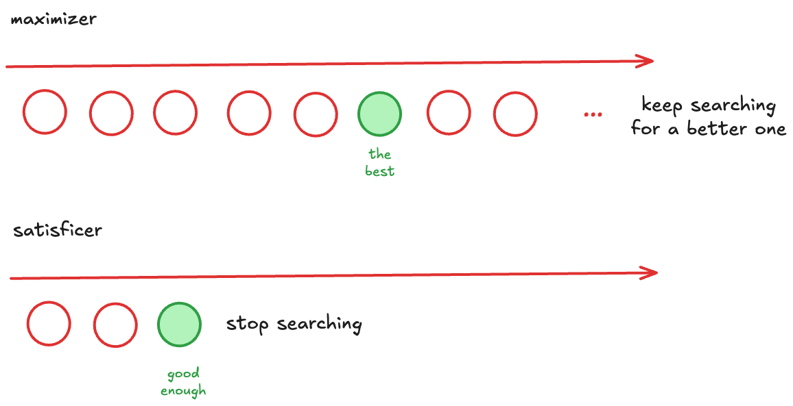
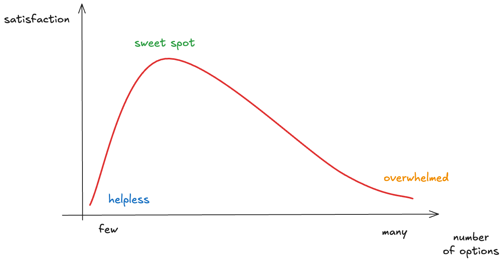

### On the paradox of choice and the case for commitment

*A demesne wall south of Birr, Co. Offaly, Ireland. Photo: Jonathan Thacker, [CC BY-SA 2.0](https://creativecommons.org/licenses/by-sa/2.0/), via geograph.org.uk / Wikimedia Commons*

Years ago I heard a story told by the Irish writer Frank O'Connor. When he was a boy, he and his friends would wander the countryside, past an orchard. And they really wanted the apples that grew there. But there was a high wall. They weren't sure they could climb it. So, to encourage themselves, they tossed their caps over the wall. The caps were valuable to them. Now there was no other choice. They had to climb.

Frank O'Connor put this story in his memoir, *An Only Child* [1]. But it traveled further. In November 1963, in San Antonio, John F. Kennedy used it to make the case for the space program: "This Nation has tossed its cap over the wall of space, and we have no choice but to follow it." [2]

## Comparison Engines

We live with a common intuition that infinite freedom is something desirable. That more options lead to better choices. That constraints make us less creative. But abundance of choice is often overwhelming. Our brains evolved in an environment of scarce options, where having any choice at all was a good thing. The instinct that more choice is better probably comes from there.

Barry Schwartz, in *The Paradox of Choice* [3], describes two choice archetypes: maximizers and satisficers. A maximizer wants to search the whole problem space and find the best solution. A satisficer sets a standard and stops when it's met.

Here's the catch: maximizers often get better objective results, but subjectively feel worse about them than satisficers do.

Why? Because we are comparison engines. We have no ability to rate anything in absolute terms. So we compare. And comparison usually makes us miserable and regretful. We chose a decent car. For a moment, we even liked it. But there were other options. And they could have been better. We compare against the options we didn't take, and against other people. In the past, we compared within our close vicinity. Now, in our globalized reality, we compare against the entire world [4].

No one, of course, is purely a maximizer or a satisficer. These are tendencies. But the modern world keeps pushing the maximizer tendency to the front.

## Sliding Is Not Deciding

The maximizer in us doesn't only shape what we pick. It shapes how we treat the decision itself. Not only do we want to expand the set of options — we want to keep optionality as long as possible, and we treat reversibility as something valuable in itself. But a pile of choices, especially complex ones, often leads to avoidance. We don't want to bear responsibility for a bad decision. So we keep options open, or at least make sure we can undo them. We think it's better for us.

But we are not the best judges of our own needs. We often confuse what we think we want with what we really need. Nowhere is this more visible than in our modern approach to relationships. We focus on finding the proper match — keep the range of options wide, choose the right one. And in that landscape, we underestimate the work that starts after the decision is made. When we face obstacles and problems, we read them as proof of a wrong choice. Not as work that needs to be done to build something meaningful.

Sliding along, keeping options open — that is often no decision at all. And even when we do decide, the open back door works against us: people are *happier* with irreversible decisions [5]. The better option (sic!) is to choose something that meets our standard, and invest the energy in making that decision right.

## Unteachable Lessons

Of course, none of this is binary: abundance of choice versus no choice. There is a sweet spot between them, and it is worth looking for.

We can constrain ourselves intentionally — limit the number of options we consider, set a deadline for deciding. It starts with unlearning two assumptions: that more is always better, and that reversible is always good. To be clear: commitment is not stubbornness — making a decision right is not the same as refusing to admit it was wrong. Still, we wait to feel fully ready, fully sure, before we decide. But some lessons are unteachable. They can't be studied in advance — only learned by experience. Nobody is ever *ready* to become a lifelong partner or a parent. You learn to be one only by being one [6]. So we toss our caps over the wall. And then we make the best of it, instead of asking whether the toss was a good idea.

---

## References

[1] Frank O'Connor, *An Only Child* (1961). See also: [Toss your cap over the wall!](https://www.steve-johnsen.com/286/toss-your-cap-over-the-wall/)

[2] John F. Kennedy, [Remarks at the Dedication of the Aerospace Medical Health Center, San Antonio, November 21, 1963](https://www.jfklibrary.org/archives/other-resources/john-f-kennedy-speeches/san-antonio-tx-19631121)

[3] Barry Schwartz, *The Paradox of Choice: Why More Is Less* (2004)

[4] David Epstein, [Why You Feel Overwhelmed All The Time (and how to fix it)](https://podcasts.apple.com/zw/podcast/why-you-feel-overwhelmed-all-the-time-and-how-to-fix/id1347973549?i=1000776074261), Modern Wisdom #1121 (2026)

[5] Daniel T. Gilbert & Jane E. J. Ebert, [Decisions and Revisions: The Affective Forecasting of Changeable Outcomes](https://gwern.net/doc/psychology/2002-gilbert.pdf), *Journal of Personality and Social Psychology* (2002)

[6] L. A. Paul, *Transformative Experience* (2014)
