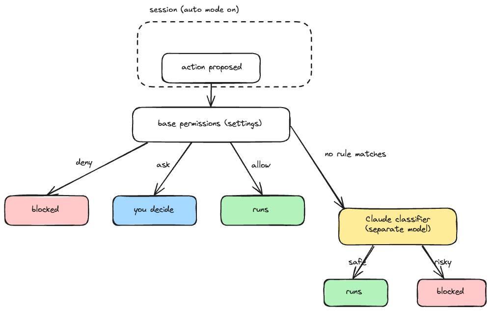
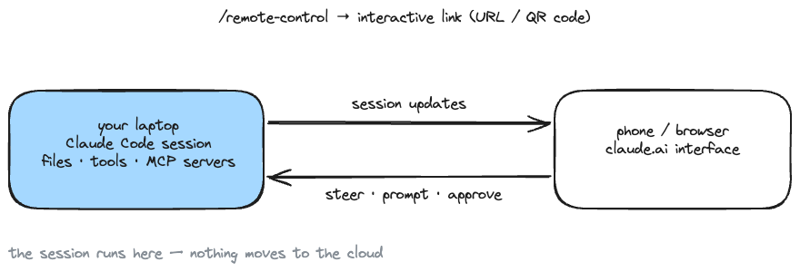
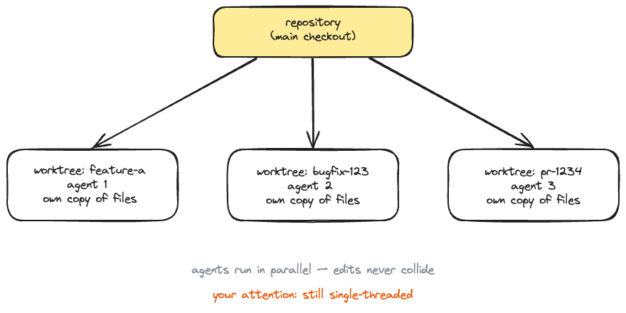
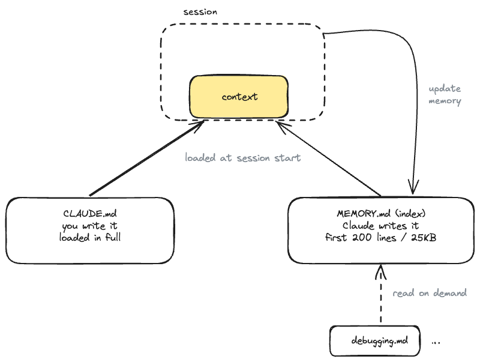
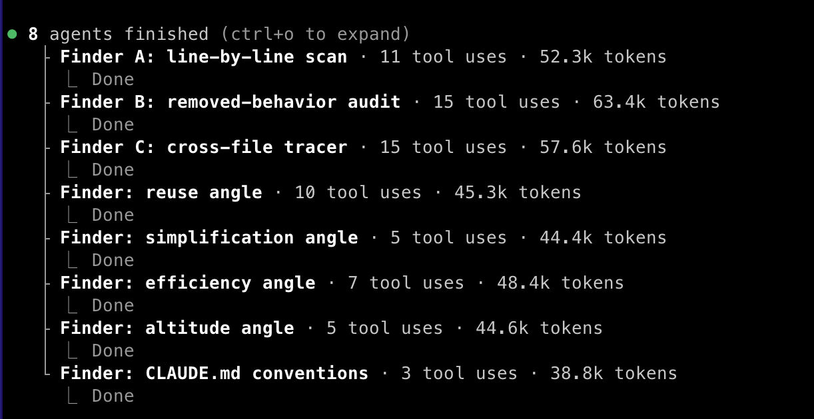
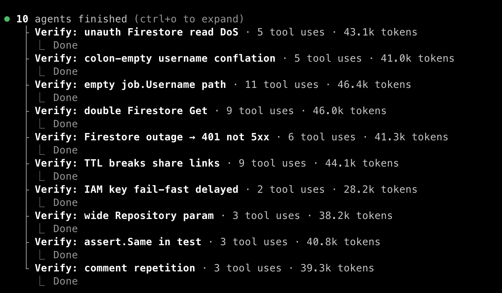

*Automode, memory, routines, worktrees and code reviews.*

Claude Code is a great tool that is evolving really quickly. In recent weeks, a lot of voices have been announcing a paradigm change: from prompts, through harnesses, to loop engineering. I don't buy this narrative. The improvement is real — but it's still a tool. In this post I'd like to share a few of the newer features from the Claude Code toolkit. Some of them I really like; toward some I'm a little reserved.

## Automode

[Automode](https://code.claude.com/docs/en/auto-mode-config) is a feature I really like. It was quite common for me to trigger some investigation and leave the desk. When I returned, I saw that Claude hadn't even started, because it had been waiting for permission to fetch some URL. Security is a real thing in handling AI agents — I don't want to underestimate it. But we need a kind of balance, a sweet spot. [Anthropic reports](https://www.anthropic.com/engineering/claude-code-auto-mode) that users accept 93% of manual permission prompts anyway — constant asking breeds fatigue and automatic acceptance instead of reading.

In automode, a separate classifier model evaluates whether each action is safe, and Claude proceeds without asking; settings remain the manual fallback. Usually it means the agent works without any user prompts. You can switch modes with `shift+tab` in the terminal.

To stay on the safe side, I would recommend mixing it with a kind of base permission model: some operations are unconditionally denied, others are left for the user to decide, and the rest are accepted or evaluated by Claude's classifier.



```json
{
  "permissions": {
    "defaultMode": "acceptEdits",
    "deny": [
      "Read(./.env)",
      "Read(./.env.*)",
      "Read(**/.env)",
      "Read(**/.env.*)",
      "Read(**/*.pem)",
      "Read(**/*.key)",
      "Read(**/secrets/**)",
      "Read(~/.ssh/**)",
      "Read(~/.aws/**)",
      "Read(~/.config/gcloud/**)",
      "Bash(curl * | bash)",
      "Bash(curl * | sh)",
      "Bash(wget * | bash)"
    ],
    "ask": [
      "Bash(git push*)",
      "Bash(npm publish*)",
      "Bash(docker push*)",
      "Bash(terraform apply*)",
      "Bash(kubectl*)"
    ],
    "allow": [
      "Bash(npm test)",
      "Bash(npm run build)",
      "Bash(npm run lint)",
      "Bash(git status)",
      "Bash(git diff*)",
      "Bash(git log*)"
    ]
  }
}
```

## Remote Control

Remote control is something I don't use a lot. It allows you to generate an interactive link to your local conversation and track or modify it from the claude.ai interface. So you can trigger something on your laptop and then monitor or handle it from your phone. You start it with the `/remote-control` command.



## Worktrees

Git worktree is a native Git feature that allows you to check out multiple branches of the same repository simultaneously, into separate physical directories. Normally a repo has one working directory, so switching branches means stashing or committing your current work first. Claude can [create worktrees](https://code.claude.com/docs/en/worktrees) for itself or its subagents — you start one with `claude --worktree feature-auth`, or branch straight from a pull request with `claude --worktree "#1234"`. So agents working on different features or PRs don't interfere with each other, because each works on its own copy of the files.

But I'm not a big fan of multitasking. I think it gives us a false sense that we're doing many things at the same time — while keeping the context of a specific task, switching it, and rebuilding it again is costly and exhausting. So while it seems tempting, I rarely use this feature.



## Automemory

[Automemory](https://code.claude.com/docs/en/memory) is a built-in mechanism that keeps Claude from starting each session from scratch. It's quite similar to CLAUDE.md — the file with persistent instructions for Claude — but rather than being provided by the user, it's curated by Claude. Both share the same restriction, though: they're loaded into context at the start of every session, and anything loaded as context competes for attention — bloat degrades adherence regardless of which file it lives in. That's why memory is indexed and truncated: the MEMORY.md index pulls at most 200 lines (or 25KB) into context, while detailed notes live in topic files that Claude reads on demand.

Memory also has a mitigating factor CLAUDE.md lacks: it's self-curating. Claude decides what's worth remembering based on whether it would be useful in a future conversation — selective by design, rather than accumulating everything you ever felt like writing down. Automemory is on by default; to toggle it — or to view and edit what's stored — open `/memory` in a session.



## Code Review

The code review feature is something I underestimated before I tried it. I thought it would just add some simple tips to my code. Instead, it runs multiple finder agents, each scanning your changes from a different angle.



When the finding step is done, it fires another pool of agents as verifiers.



At the end, the analysis is deduplicated and refined, and you get several findings about what can be wrong with your code. Usually these findings are not trivial and can genuinely improve your codebase — for example, from a security perspective. In my case, it warned that a weak authentication scheme could lead to a DoS on Firebase if I didn't have proper rate limiting on the endpoint. The caveat: this multi-agent analysis burns a lot of tokens, so it's quite heavy — in my run, the finders and verifiers together used around 800k tokens for a single review. I would avoid it for a straightforward PR. But if you're working alone, or need additional eyes and different perspectives, it's worth trying. You trigger it with `/code-review`.

## Routines, Loops, Goals

As I mentioned in the intro — and in a [previous post](https://jorzel.github.io/three-doubts-about-loop-engineering/) — I'm not fully on board with the narrative that loop engineering will take over our current approach to writing software. Claude allows us to run intelligent crons: [routines](https://code.claude.com/docs/en/routines) (`/schedule`) that execute in the cloud, and short-period checks (`/loop`) that run inside a local session. Routines can run at most once an hour, while loops can be much denser — down to a one-minute interval. However, I still don't see much application for them.

I tried a simple routine that fetches the Hacker News top stories every hour and builds a dashboard. The problem: the agent works in Claude's cloud instead of locally, so I had no persistence to save my data between runs — each run starts from a fresh container. Claude suggested using a git repo as a kind of append-only log. Ok. But I'm still not sure this brings something that solves my problems.

Regarding [`/goal`](https://code.claude.com/docs/en/goal) — which keeps a session working turn after turn until a condition is met: I can see it being useful when, for example, I need to rewrite a whole system from one tech stack to another. But for day-to-day work? Almost all agentic work already has a loop inside itself — that's how it delivers results from a prompt. At this stage, I don't see a revolution. And I'm probably not alone. Gergely Orosz [asked recently](https://x.com/GergelyOrosz/status/2076591749309374650): "What is 'loop engineering' to you, anyway? … I'm not (yet?) buying that it's a new paradigm. But I might just be missing something."

---

The toolkit changes faster than the narrative. I'll keep testing.
