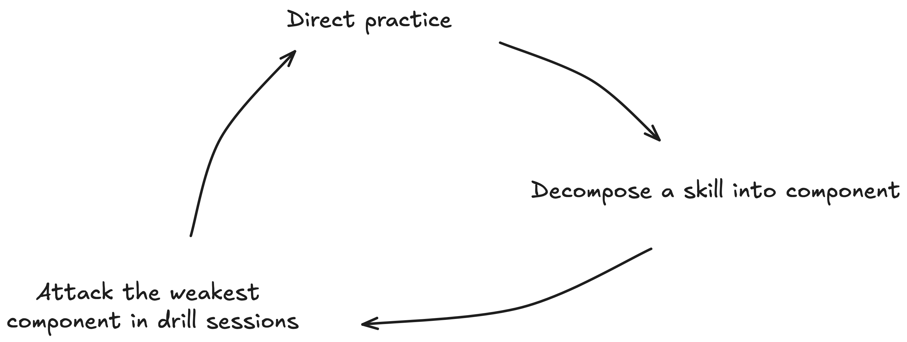

In our approach to learning, we would like to find a golden rule. Something that is always true. General, universal advice we could equip our kids with: follow this principle and you will surely succeed. That's probably why we love proverbs and sayings like "Repetitio est mater studiorum," "Success is the best teacher," "We learn the most from failures."

But gather all these sayings together and you notice something: there is a kind of built-in contradiction in them. Success teaches best — and failure teaches most? In complex domains like learning, this is normal. Because there is no simple, once-and-forever answer that suits everyone. Learning is more contextual than any single rule can capture.

## Directness and Drill

As a kid, I played a lot of tennis. With friends, we loved matchplay. It was real fun. Competition. Points. And each point matters. That's directness: you practice a skill the same way you use it.

Although directness builds overall ability, it usually leaves gaps in specific areas. You are late on volleys. Your serve is not placed the way you would like. To improve specific aspects of your play, you need drills — narrowed exercises that focus on one area and deliberately skip the rest. It can be daunting. It can be boring. But often it is the only way to push your matchplay to a higher level.

Currently I am learning to play padel. There is a strong inclination in me to only play competitive games. My tennis skills make padel directness the easy path. But I know there is a ceiling I will not break unless I spend some time with a coach, training padel-specific shots.

So there is no simple answer to whether directness is your way, or whether your practice needs more drill. It depends. On you, what you do, and where you are.

## Balancing the Opposites

This isn't a racket-sports quirk; every corner of learning has such a pair.

Take "We learn the most from failures." I have often heard that a defeat can be the best source of feedback. What is wrong, what needs to be improved. However, at the very beginning of your journey you need some signs of ability. That you can do it. If you fail a lot as a beginner, the only conclusion you draw is: "this is not for me."

That's especially important for kids. When they take up something new, they need small successes first. They need scaffolding to experience small wins. "Success is the best teacher" works then.

When you are established in the domain, practice needs to be harder. And failures become an indicator of whether you are stretching yourself. Whether the bar is set high enough.

"Practice makes perfect." That's true. But sometimes it is not enough to make progress. Your practice may take a lot of effort while the outcome stays unsatisfying. The passive approach — watching, reading, searching — is often underestimated as a second-class category. But in many cases it is a door opener.

Tetris is a great example. For decades, [the world record was stuck at level 29](https://www.youtube.com/watch?v=mOJlg8g8_yw). Then YouTube came, and with it the possibility to watch other players and their strategies. By seeing others play, people were able to improve their technique and find better ways. The record fell.

Sometimes you need more practice to get unblocked. Another day, you need to broaden your horizons and find a totally different way.

This Tetris story is also a nice example of discipline vs freedom. The players who broke level 29 didn't do it by ignoring fundamentals. They mastered the classic technique first, and only then invented new ones: hypertapping, rolling. Freedom to innovate arrived on top of the base, not instead of it. Whether to stick to the classic technique or to invent was all about timing.

## Where You Are

Timing operates at two scales. Some balances flip once with your place on the career scale: you do things differently as an amateur and change your approach as an expert. Others alternate continuously within the current session: you navigate what to practice today, and what will bring more benefits tomorrow. No universal rule survives either scale.

As a beginner, you want to decrease the number of moving parts. At the very beginning, you cannot handle many aspects at once. I am not able to move quickly on the court and hit the ball at the same time. So I get balls from the trainer without running: training only the shots, leaving footwork and coordination for later. You focus on one thing to avoid being overwhelmed. High success rate first; difficulty, variability, and freedom ramped up later. "Repetitio est mater studiorum" after all. But only at the start. Sheer repetition is the entry point; over the course of learning, variability takes over its job.

Flight simulators show how far this goes. In the early stages of training, they accelerate pilots' learning. Later, the same simulators can become harmful — pilots get used to features that real aircraft don't have. The tool didn't change. The learner did.

The key in learning is not the universality of rules, but contextuality and flexibility. The best learners are the ones who can find the right balance at the given time. The question shifts from "what works?" to "what works *at this point*?"
