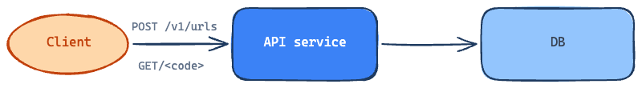
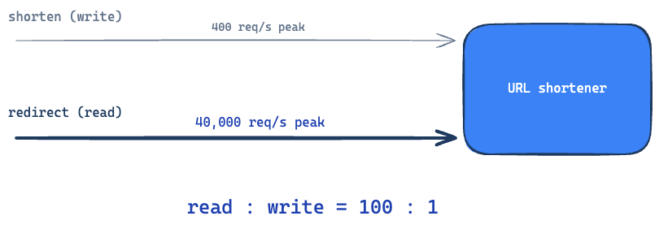
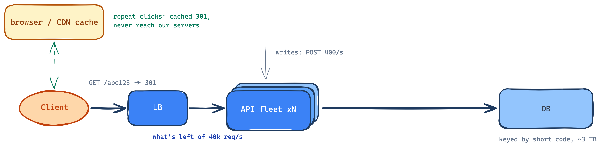
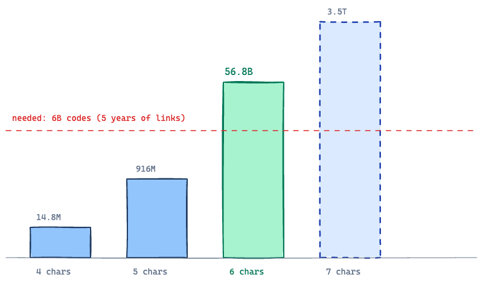
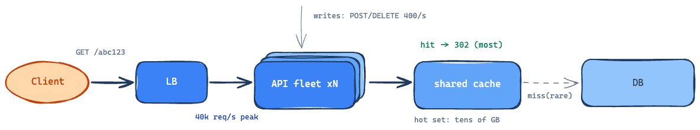

### How a single requirement reshapes a URL shortener design

I've run a lot of design interviews in my career. They were usually not meant to be a comprehensive trade-off exercise, designing for scale. I presented a simple problem, indicating it needs to be clarified. The simplified requirements I handed out gave some indication of what the core functional requirements were. But I was astonished how few people asked clarifying questions. Should links expire? Can users delete them? What should the latency be? How many requests do we handle?

People going into interviews often ask questions because they know they should. That's the unwritten rule of system design tasks. But these questions are not meant to be part of the interview ceremony. They are meant to drive the design. And this is probably the most important and the most difficult thing in designing: being able to clarify the requirements - both functional and non-functional - and genuinely drive the design by them.

If you do not ask questions, it is really bad. You are not even playing the game. If you ask them and your design is detached from the answers, you show that you know the rules - but you are not capable of really playing.

So asking questions is fundamental to making proper design decisions. There is one caveat, though. Usually we think it is mainly the non-functional requirements that drastically change the design: how many requests we want to handle, what the latency should be, how much data we need to store. However, I want to show that a functional requirement like revocation can profoundly change the system architecture.

---

## The Naive Approach

The URL shortener is one of the most common system design questions. Without any additional requirements, the topic seems straightforward. You have a long URL, and you would like to represent it by a short equivalent:

`www.really-long-url.com/see-my-pictures-here` → `www.short-url.com/y1zyA5`

`y1zyA5` is the short code.

Nothing to deliberate on. We need two REST API endpoints:
- one that provides the shortened version of a URL
- one that redirects to the original URL based on the short one

Behind the endpoints, we need a database to store the mapping. That's all.

From a top-level perspective, everything seems to be covered. We have an API to expose our system and a database to store the mapping.

However, many silent choices were made here.
- How do we generate the short URL from the long one?
- How many characters do we need - 5? 10?
- Our GET endpoint responds with a redirect to the long URL. But is it a 301 or a 302? Does it even matter?
- Is it a single-node system? Can it scale?
- Do we need a cache?

Each of these choices depends on clarifying questions about the requirements. Questions that were never even asked.

---

## Add the Numbers

The proper approach is to clarify the problem first. Almost every design task comes with generic questions that need to be asked:

> **Candidate:** How much traffic do we need to handle?
> **Interviewer:** 100M new URLs a month and 10B redirects a month.
>
> **Candidate:** What should the latency of a redirect be?
> **Interviewer:** p99 < 100 ms.
>
> **Candidate:** How long should we store the links?
> **Interviewer:** Forever.
>
> **Candidate:** What is more important: availability or consistency?
> **Interviewer:** Availability. A new link can take a few seconds to become visible.

Each answer narrows the problem down or makes it more precise. It should lead to some calculation on the candidate's side: is our problem read-heavy or write-heavy? Is it a latency problem (quick responses) or a storage problem (large amounts of data)?

**Traffic**
- 1 month ≈ 30 × 24 × 3,600 ≈ 2.6M seconds
- Writes: 100M / 2.6M ≈ 40/s on average
- Reads: 10B / 2.6M ≈ 4k/s on average
- Peak ≈ 10× the average, so 400 writes/s and 40k reads/s

So almost all the design effort goes into the read path.

**Storage**
- 100M links a month × 12 months × 5 years = 6B records
- One record ≈ 500 B: the 6-character code, a long URL (typically 100–200 B, though URLs can be much longer), a creation timestamp, and a generous allowance for indexes and storage overhead
- 6B × 500 B ≈ 3 TB

That fits on one SSD, so this is a latency problem, not a storage problem.

A single node can't handle 40k reads/s and still meet the p99 < 100 ms target. We need a load balancer with a few stateless, horizontally scalable API servers behind it. Since the problem is read-heavy, the database should be chosen for fast lookups by the short code.

Adding servers scales our capacity, but the cheapest read is the one that never reaches them. So we deliberately return a 301 (Moved Permanently). Browsers and CDNs cache the response, and a cached redirect never reaches our servers again. HTTP does the read scaling for free.

Writes are a much smaller problem. First, how long does the code need to be?

**Code length** (62 symbols: a–z, A–Z, 0–9)
- 5 characters: 62⁵ ≈ 916M, which is too few for 6B records
- 6 characters: 62⁶ ≈ 56.8B, about 9× headroom
- 7 characters: 62⁷ ≈ 3.5T, enough for decades

A 6-character short code is enough to handle the requirements.

The easiest way to approach the write path is to generate 6 random characters for each short URL. Every write should go through an atomic uniqueness check and retry when the code is duplicated. If collisions become frequent and annoying, we could consider a ticket server that hands out ranges of an auto-increment counter. However, this option introduces more complexity: a new component to run, ranges to design, and a plan for when the ticket server is down.

---

## Add One Checkbox

With all these requirements gathered, the design grew, but stayed simple. The requirements were kind to us. Now, however, I want to show how a single small functional requirement can change the design profoundly.

> **Interviewer:** One more thing: owners should be able to revoke their links.

One more checkbox on the requirements list: revocation. A revoked mapping is retired and removed. We used the 301 response code, which made browsers and CDNs remember the redirect. Now we can't use it, because a remembered redirect would go stale after the revocation. So we have to use 302, and every click - all 40k reads/s at peak - reaches our servers.

Caching now has to happen on our side. We need to introduce a cache shared by all our servers, and we need to be able to invalidate it on revocation.

Hot codes, however, can be an issue for this cache when many users fetch the same URL. One viral code always lands on the same cache node, so that node becomes a hotspot. And if that one entry disappears (evicted, revoked, or the node restarts), every request for it falls through to the database at once. A tiny per-server cache with a few seconds' lifetime can improve the hot path, and it is quite an easy first option to take.

The price is that a revoked link may keep working for those few seconds, and our availability answer allows it: if a new link can take a few seconds to appear, a revoked one can take a few seconds to disappear.

---

## Back in the Interview Room

In our example, the traffic numbers decided how big the read load is, but one simple functional requirement decided who has to serve it. Every requirement is a commitment, and none of them should be underestimated.

Clarifying questions are not just part of the ceremony. Questions about traffic, latency, storage size, and retention time belong in almost any design problem, so asking them is the easy part. A candidate who understands how requirements shape architecture does more than ask. They let the answers drive the design.
