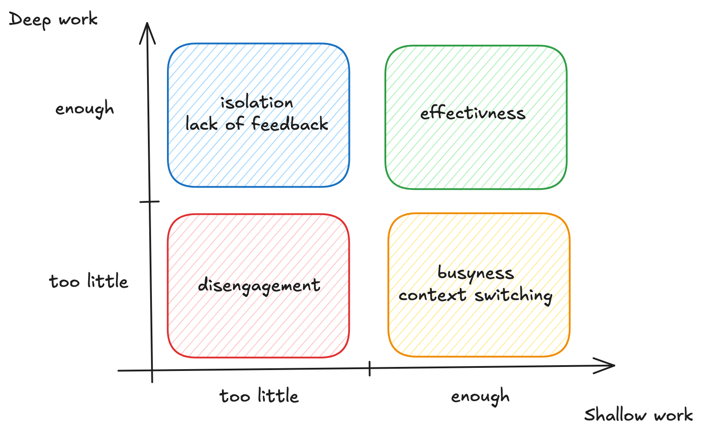

*Agents made software work shallow. Depth now has to be designed.*

In 2022, I wrote [an article about deep work](https://jorzel.github.io/deep-work-essentialism-in-asynchronous-culture/): why it matters for software developers and how to design your time to make it possible in asynchronous, distracting environments. Back then, successful deep work was mainly about managing your interaction with the environment. Keep distraction-free focus time. Work with full concentration. The deep–shallow design of a workday was crucial. The work itself was deep. We just had to protect it.

Now it is not enough. In software development, the nature of the work itself changed. Focus on the task was replaced by delegating it to agents and verifying their output. In the past, software development was intrinsically deep (if you were able to find space for it). Today, it has become intrinsically shallow.

## Intrinsically Shallow

A few years ago, a properly designed workday looked something like this. You got a challenging issue: implement a new feature in your system. You found a slot in your calendar. Turned off notifications. Timeboxed the task. Design first, then implementation. All the work done in high focus on what you read and typed.

Now? You read the ticket description. Sometimes you think a little about the problem. But usually you just prompt and delegate the task to the agent. You're probably working in auto mode, with crafted permissions, so the agent doesn't bother you with unnecessary questions. The only thing left to do is wait until you can verify.

But waiting is boring. It's hard to sit for a few minutes, still thinking about the problem, while the agent does the work on your behalf. So you switch context to a different problem and fire up another agent. Or read something on the internet. Or reply to a friend. Anything. And your deep work is gone.

I don't think it's your inability to focus. Delegation and conversation — even with an agent — are intrinsically shallow work. Maybe within one session you can keep your focus on a single topic while tackling a problem with your agent. But in the long run, context switching and distraction become the natural way of working. So the change is not in the design of the day. It's in the nature of the work. Software is just where agents arrived first. Writers, analysts and designers are next.

## Surrender by Detachment

We can say: it is what it is. The way we work now makes us more productive. We deliver more. There's no going back to the way we worked in the past. That's true. But it's also true that this way of working has side effects.

Deep work, I would say, is the way we grow. I genuinely believe it stretches your mind and improves your skills. So the question is whether we can get better without a stable deep work practice. If we lose it, our skills may not only stop improving. They may deteriorate.

[Addy Osmani writes about cognitive surrender](https://addyosmani.com/blog/cognitive-surrender/): the more coding you hand to agents, the more you risk losing the very skills needed to supervise them. In the short term, we're faster and more productive. In the long term, we slowly lose the skills that made us experienced engineers. We become more and more detached from the craft — the same craft we need to verify what agents produce. That's cognitive surrender. It's how comprehension debt accumulates.

Even if agents can do most of the work — and more of it every year — you still need a skillset to be successful, even if that skillset evolves. [Here Be Monsters](https://blog.adrq.dev/here-be-monsters-what-do-you-still-need-to-know-when-agents-do-the-work) is a good attempt to map what it looks like.

We've probably lost deep work as a natural part of our jobs. So where can we still find it?

## Friction by Design

Some people say: "Agents save me time, and I can preserve it for deep work." It's a good approach. But it rarely happens on its own. This is the [efficiency trap](https://jorzel.github.io/efficency-traps/) striking again. Improved efficiency doesn't give us more free time. We just do more work. Our worktime is usually stable; the amount of work is not. The saved time ends up in more delegation and more context switching.

So we need to be even more proactive in designing our time. Not to bring the old kind of deep work back into our tasks, but to preserve time for deep work in learning. If your tasks no longer cultivate your skills, you need to find a space in your workday to sharpen them. Reserve 1–2 hours a day in your calendar [for learning](https://x.com/milan_milanovic/status/2116794624933257567).

Learning, to be fruitful, needs friction. That's the opposite of how we work with agents. Friction enforces concentration and focus. Monitoring an agent's work is frictionless.

Recently, I tried no-AI coding tasks. I built my own Redis and a shell that way. You can still pair with your AI to get hints, but you solve the problem yourself. The agent doesn't write the code. That forces you to think about the design and weigh the options. It's the difference between passively watching material and [retrieval practice](https://journals.sagepub.com/doi/10.1111/j.1467-9280.2006.01693.x): you have to produce something, not only consume it. And that makes the knowledge more durable. [CodeCrafters](https://codecrafters.io) is a good place to start.

Solving interview questions is also a good way to stretch your mind and develop your knowledge. To understand a new idea, rebuild it from scratch, as small as possible ([a loop attributed to Andrej Karpathy](https://x.com/DmitroCP/status/2114303402083856499)), or explain it in plain words until you stop stumbling (the Feynman technique). Both expose the gaps you didn't know you had.

Don't take the easy way and delegate. Face the problem, and don't hand the solution to AI.

## An Investment, Not an Escape

Since 2022, my opinion about deep work has evolved a little. I think the approach should be more contextual. Entrenching yourself in deep work can be harmful — both for you and for the organization. A developer who goes dark for days, while the team waits for reviews and answers, isn't helping anyone. It needs to be balanced to bring gains both personally and for the company.

So I don't think we need a whole deep workday back. Most of the day can stay shallow: delegating, verifying, answering the team. But you need some intentional deep slots. It's a long-term investment in your craft. The same craft you need to verify what agents produce.
